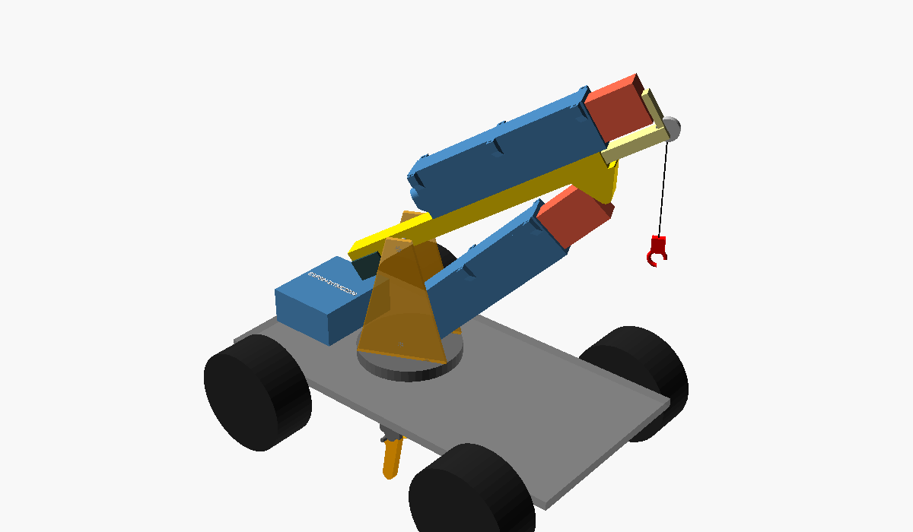
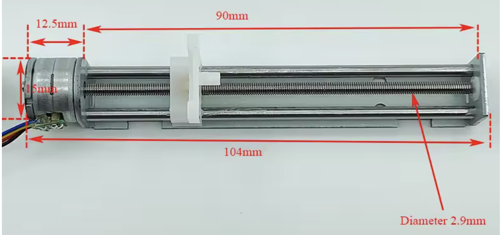
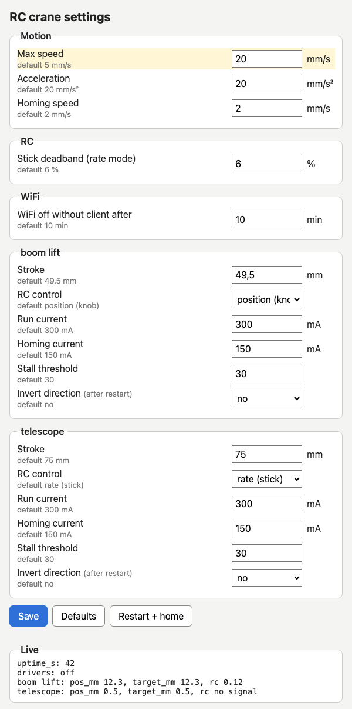

# RC Crane – Stepper Linear Actuator Controller

[](https://github.com/35services/linear-actuator-crane/actions/workflows/render-cad.yml)



**All CAD renderings and printable STLs:** [`cad/`](cad/README.md). **Carrier PCB, ready to order:**
[`pcb/`](pcb/README.md), as a through‑hole version for hand soldering or an SMD version
assembled by JLCPCB. **Advanced board** with an ESP32‑S3, 4 stepper drivers, 16 servo/ESC
outputs, RC and CRSF/SBUS inputs: [`pcb/advanced/`](pcb/advanced/README.md), or the same as a
[stack of two smaller boards](pcb/advanced-stack/README.md). The concept sketch
that started it is [`gemini.jpeg`](gemini.jpeg).

Drive two mini stepper‑motor linear actuators (2‑phase, 4‑wire, lead screw + slider) from
normal RC receiver channels to work a crane on an RC model vehicle:

* **Boom lift:** actuator 1 raises and lowers the boom.
* **Telescope:** actuator 2, lying on top of the boom, extends the inner boom section.

Features:

* **No end switches.** On power‑up both actuators home themselves using **sensorless
  homing** (TMC2209 StallGuard). If stall detection isn't reliable on your motors, they fall
  back to **hard‑stop homing**: each one drives into its mechanical end at low current.
* **Plug‑and‑play with RC.** The ESP32 reads a standard servo PWM signal (1000–2000 µs) from
  one receiver channel per actuator.
* **Battery friendly.** Lead screws are self‑locking, so the drivers are switched off when
  idle and the load still holds.

---

## 1. How it works

```
                          ┌──── servo PWM (CH a) ──┐
 Transmitter ──radio──► RC receiver                ▼
                          └──── servo PWM (CH b) ──► ESP32-C3
                                                     │   ▲
                       shared UART + EN, own STEP/DIR│   │ DIAG (OR'ed)
                                     ┌───────────────┴───┴──────────────┐
                                     ▼                                  ▼
                              TMC2209 #0 (addr 0)               TMC2209 #1 (addr 1)
                                     │                                  │
                              actuator 1: boom lift             actuator 2: telescope
```

1. **Power‑up:** the ESP32 configures both TMC2209s over one shared UART line. They have
   different addresses, set with the MS1/MS2 pins.
2. **Homing,** one actuator at a time. The **telescope goes first**, so the boom moves with
   the shortest lever.
   * The actuator drives toward its retracted end at low current.
   * With **StallGuard**, the homing driver sees the motor load spike and pulls `DIAG`
     high, so the ESP32 stops right away. Only the homing driver has its stall output
     enabled, so the two `DIAG` lines can share one GPIO.
   * Without StallGuard (or if no stall is detected), the motor runs for the full stroke
     plus a small margin. At low current it just skips a few steps against the end, which
     does no harm, and that point becomes position 0.
3. **Run:** each RC channel controls one actuator, in either
   * **Position mode:** stick or knob position = actuator position. The default for the
     boom lift, best on a knob or slider.
   * **Rate mode:** stick deflection = speed. The default for the telescope, best on a
     self‑centring stick.
   Soft limits keep each slider a little away from both ends, so it never crashes again
   after homing.
4. **Failsafe:** if no valid RC pulse arrives on a channel for 250 ms, that actuator stops.

---

## 2. Components

| # | Qty | Part | Notes | ~Price |
|---|-----|------|-------|--------|
| 1 | **2** | Mini stepper linear actuator (the AliExpress part) | 2‑phase, 4‑wire. 18° (20 steps/rev), M3 screw with **0.5 mm lead**, **~75 mm stroke** (counted from the listing photo, see [Speed](#speed-how-fast-can-it-move)) | 2 × €11 |
| 2 | 1 | **ESP32‑C3 SuperMini** (or Seeed XIAO ESP32‑C3) | Tiny, 3.3 V logic, USB‑C | €3 |
| 3 | **2** | **TMC2209 stepper driver module** (BigTreeTech v1.3, FYSETC or similar, *UART version*) | Quiet (StealthChop), current set over UART, **StallGuard for sensorless homing**, 4.75–29 V | 2 × €4 |
| 4 | **2** | Electrolytic capacitor **100 µF, ≥ 25 V** (35 V recommended) | One across each driver's VM/GND, close to the module. **Required.** | €0.40 |
| 5 | 1 | Resistor **1 kΩ** | Single‑wire UART (between TX and the shared PDN_UART line) | – |
| 6 | 2 | Diode **1N4148** (or any small signal diode) | OR both `DIAG` outputs onto one GPIO | – |
| 7 | 1 | Resistor **10 kΩ** | Pull‑down on the shared `DIAG` line | – |
| 8 | 2 + 2 | Resistor **1 kΩ** + Schottky diode **BAT85** per RC channel | Series resistor + clamp to 3V3, so any receiver signal level (3.3 V, 5 V or the 7.4 V BEC rail) is safe | – |
| 9 | 1 | **LM2940CT‑5.0** low‑dropout regulator (TO‑220) | 5 V for the ESP32 from the 6 V / 7.4 V BEC rail. See [Power](#4-power) | €1.50 |
| 10 | 1 + 1 | Capacitors **470 nF** ceramic (LDO input) + **47 µF / 16 V** electrolytic (LDO output) | The LM2940 needs ≥ 22 µF on its output to be stable | – |
| 11 | 1 | Schottky diode **1N5817** | LDO → ESP32 5V pin. Stops USB from back‑feeding the regulator while flashing | – |
| 13 | 2 | Servo extension lead | Receiver channels → board | €2 |
| 15 | 1 set | Nesting square tubes (aluminium/brass, e.g. 16×12 and 11×7 mm) | Telescopic boom. See [Mechanics](#5-mechanics) | €5 |
| 16 | | [Carrier PCB](pcb/README.md) (or perfboard), JST‑XH connectors, female pin headers, heat‑shrink | | |

**Vehicle drive (for reference):** Hobbywing **QuicRun Fusion SE** 1800 kV crawler motor/ESC
combo. It takes 2–3S LiPo (up to 12.6 V) and has a switch‑mode **BEC of 6 V or 7.4 V
(switchable), 4 A**. The crane electronics are designed for both BEC settings.

### Why the TMC2209?

| Driver | Sensorless homing | Noise | Current setting | Verdict |
|--------|-------------------|-------|-----------------|---------|
| **TMC2209** | ✅ StallGuard4 | silent | software (UART) | **Recommended** |
| TMC2208 | ❌ | silent | potentiometer/UART | OK, hard‑stop homing only |
| A4988 / DRV8825 | ❌ | loud | potentiometer | Works, but crude for tiny motors |
| DRV8833 (H‑bridge) | ❌ | – | none (voltage‑driven) | Only for 5 V motors on a 5 V supply. No current limit |

> **What's the little potentiometer on the TMC2209 module for?** The onboard pot sets
> motor current in standalone mode via VREF, but since our firmware controls current over
> UART and disables VREF with `I_scale_analog(false)`, the pot has no effect and can be
> ignored.

---

## 3. Wiring diagram

Both drivers are wired the same way. The only differences are **STEP/DIR**, the **address
pins** and the **diode on DIAG**.

```
  2S/3S LiPo ──► Hobbywing QuicRun Fusion SE (ESC) ── BEC 6 V / 7.4 V, 4 A ──► RC receiver
                                                                                  │
         BEC + / − arrive on the board through the RC servo leads (CH a, CH b) ◄──┘
                     │
       ┌─────────────┤
       │ BEC + (VM)  │ GND (−)
       │      ┌──────┘
       │ (+)  │ (-)
       ├──────┼────────────────────────────────────────┐
       │      │      100 µF                    │      │      100 µF
       ▼      ▼     ┌─┤├─┐                     ▼      ▼     ┌─┤├─┐
   ┌───────────────────────────┐           ┌───────────────────────────┐
   │   TMC2209 #0 (boom lift)  │           │   TMC2209 #1 (telescope)  │
   │                           │           │                           │
   │  VM / GND ◄── BEC         │           │  VM / GND ◄── BEC         │
   │  1A 1B 2A 2B ──► actuator 1           │  1A 1B 2A 2B ──► actuator 2
   │                           │           │                           │
   │  VIO ◄── 3V3              │           │  VIO ◄── 3V3              │
   │  GND ◄── GND              │           │  GND ◄── GND              │
   │  MS1 ◄── GND  ┐ addr 0    │           │  MS1 ◄── 3V3  ┐ addr 1    │
   │  MS2 ◄── GND  ┘           │           │  MS2 ◄── GND  ┘           │
   │                           │           │                           │
   │  STEP ◄── GPIO4           │           │  STEP ◄── GPIO0           │
   │  DIR  ◄── GPIO5           │           │  DIR  ◄── GPIO1           │
   │  EN   ◄── GPIO6 (shared)  │           │  EN   ◄── GPIO6 (shared)  │
   │  DIAG ──►|──┐  1N4148     │           │  DIAG ──►|──┐  1N4148     │
   │             │             │           │             │             │
   │  PDN_UART ◄─┼──────┬──────────────────────── PDN_UART              │
   └─────────────┼──────┼──────┘           └─────────────┼─────────────┘
                 │      │                                │
                 │      │       DIAG (shared) ◄──────────┘
                 ├──────┼──────────────────────► GPIO7 ──[10 kΩ]── GND
                        │
                        ├──────────────────────► GPIO20 (RX)
                        └──[1 kΩ]──────────────► GPIO21 (TX)

                         470 nF        47 µF
                           ┴             ┴
   BEC + (6/7.4 V) ──► IN ┤ LM2940-5.0 ├ OUT ──►|── 1N5817 ──► SuperMini 5V
                              │ GND
                              ┴

   ┌────────────────────────┐                     ┌───────────────────────┐
   │     ESP32-C3 SuperMini │                     │      RC receiver      │
   │                        │                     │                       │
   │  5V  ◄── LM2940 (above)│          BEC + ◄──── + (6 V / 7.4 V)      │
   │  GND ◄──────────────────────────────────────── −                     │
   │  GPIO3  ◄──┬──[1 kΩ]──────────────────────────── S  CH a: boom lift   │
   │            └──►|── 3V3  (BAT85 clamp)         │                       │
   │  GPIO10 ◄──┬──[1 kΩ]──────────────────────────── S  CH b: telescope   │
   │            └──►|── 3V3  (BAT85 clamp)         └───────────────────────┘
   └────────────────────────┘
```

Each actuator connects to its driver exactly as before: one coil on `1A/1B`, the other on
`2A/2B`.

### Pin table

| ESP32‑C3 | → | Connects to | Purpose |
|----------|---|-------------|---------|
| GPIO4 | → | TMC2209 #0 STEP | boom lift step pulses |
| GPIO5 | → | TMC2209 #0 DIR | boom lift direction |
| GPIO0 | → | TMC2209 #1 STEP | telescope step pulses |
| GPIO1 | → | TMC2209 #1 DIR | telescope direction |
| GPIO6 | → | EN of **both** drivers | LOW = drivers on, HIGH = off |
| GPIO7 | ← | DIAG of **both**, through a diode each, plus 10 kΩ to GND | HIGH = stall detected |
| GPIO21 (TX) | → 1 kΩ → | PDN_UART of **both** | UART write |
| GPIO20 (RX) | ← | PDN_UART of **both** | UART read (direct) |
| GPIO3 | ← 1 kΩ ← | receiver CH a signal (BAT85 clamp to 3V3) | boom lift servo PWM in |
| GPIO10 | ← 1 kΩ ← | receiver CH b signal (BAT85 clamp to 3V3) | telescope servo PWM in |
| 3V3 | → | VIO of both, MS1 of #1 | logic supply / address |
| GND | – | GND of both drivers (logic side) | **common ground** |
| 5V | ← 1N5817 ← | LM2940‑5.0 output (input: BEC + from the receiver) | ESP32 supply |

### Wiring gotchas

* **Driver addresses:** #0 has MS1 = MS2 = GND (address 0). #1 has **MS1 = 3V3**,
  MS2 = GND (address 1). If both drivers have the same address, the UART check at boot
  fails for one of them.
* **DIAG – the stall signal for homing without end switches.** The TMC2209 pulls its DIAG
  pin high when the motor stalls (StallGuard).
  * **During homing:** the ESP32 watches GPIO7 and stops the actuator the moment it hits the
    end of travel.
  * **One GPIO for both drivers:** each DIAG goes through a diode (anode at DIAG, cathode
    (the band) toward GPIO7), and a 10 kΩ pull‑down holds the line low when neither driver
    signals a stall. The firmware only enables the stall output on the axis that is
    homing, so it always knows which one stalled.
  * **It needs a wire:** DIAG is **not** one of the 16 StepStick socket pins. On most
    modules it's a separate pin, and its position differs between brands. On the carrier
    PCB, run a short female‑to‑male Dupont jumper from the module's DIAG pin to the
    single socket next to the driver: **J12** for the lift, **J13** for the telescope.
  * **Without the wires:** set `USE_STALLGUARD false`, and homing drives into the end stop
    at low current instead.

  
* **Find the coil pairs** with a multimeter. The two wires that show resistance between them
  (typically 5–30 Ω) are one coil. If an actuator moves the wrong way, swap the two wires of
  **one** coil, or flip that axis's `invert` flag in the firmware.
* **Never plug or unplug a motor while its driver is powered.** That kills TMC drivers.
* Pin order differs between TMC2209 brands. Go by the labels, not by position.
  * BTT v1.3: `PDN_UART` is the pin marked **RX** (`TX` is the same net). `DIAG` is on the
    extra pin header at the top.
  * Some clones need a solder bridge to connect PDN to the header pin. Check the module's
    pinout.
* **All grounds are common:** ESC/BEC −, receiver −, ESP32 GND, both TMC2209 GNDs. With
  the carrier PCB this happens automatically through the servo leads.
* **Receiver signal level:** most receivers output 3.3 V signals, but some put out the
  servo rail voltage (up to 7.4 V with this BEC). The ESP32 isn't 5 V tolerant, so each
  channel has a 1 kΩ series resistor and a BAT85 Schottky diode from the GPIO to 3V3
  (cathode, the band, to 3V3). Anything above about 3.6 V is clamped, with at most about
  4 mA flowing into the 3V3 rail. This works with every receiver and needs no jumper.
* **Never connect the BEC + to the SuperMini's 5V pin directly.** At 6 V the onboard
  regulator is already at its limit, and 7.4 V destroys it. Always go through the LM2940.
* **Strapping pins:** GPIO2, 8 and 9 on the C3 are strapping pins and are avoided. GPIO0/1
  are normal GPIOs on the SuperMini.

---

## 4. Power

* **Everything runs from the ESC's BEC.** There's no separate battery input. The BEC
  arrives on the board through the `+`/`−` pins of the RC servo leads.
* **Motors (TMC2209 VM):** straight from the BEC rail (6 V or 7.4 V).
  * The TMC2209 works from 4.75 V, and the two small steppers draw only about 0.3–0.6 A
    together, against the 4 A BEC.
  * A "5 V" mini stepper is fine at 6–7.4 V. The TMC2209 limits the **current**, so the
    voltage only adds a little speed headroom.
  * Plug in **both** RC leads, so the current is shared between two servo cables.
  * A servo plug put on backwards is harmless: `+` is the middle pin, so only signal and
    GND swap. That's why there's no reverse‑polarity diode.
  * Set the current per axis in firmware (the `run` column in `AXES`). Rule of thumb:
    `I = rated voltage / coil resistance`. Example: 5 V / 15 Ω ≈ 330 mA → use about 300 mA.
* **ESP32:** from the ESC's BEC (Hobbywing QuicRun Fusion SE: **6 V or 7.4 V, 4 A**)
  through an **LM2940‑5.0** regulator.
  * **Why not straight from the BEC?** The SuperMini's 5V pin feeds a small 3.3 V regulator
    that is only rated to about 6 V, and the BEC can be switched to 7.4 V. Current isn't
    the issue: the ESP32 and the drivers' logic draw well under 100 mA (Wi‑Fi peaks about
    350 mA), and the BEC has 4 A.
  * The LM2940 is a low‑dropout regulator (about 0.5 V). It still delivers a clean 5 V from
    the 6 V setting, and it's rated up to 26 V. At 7.4 V it dissipates only about 0.25 W.
  * It **needs ≥ 22 µF** on its output (47 µF electrolytic) and 470 nF on its input.
  * The **1N5817** after the regulator stops the SuperMini's USB 5 V from back‑feeding the
    LM2940 while you flash it with the BEC unplugged. The SuperMini still gets about
    4.7 V, plenty for its own 3.3 V regulator.
* **Both BEC settings work.** 7.4 V is the better choice for the servos. The crane
  electronics don't care which one you use.
* **Current budget on the BEC:**
  * ESP32 plus idle drivers: about 30–60 mA.
  * Both actuators moving: about 0.6–1 A more.
  * The rest of the 4 A is left for the steering servo. On a crawler with a strong
    steering servo, keep an eye on BEC overload during simultaneous steering and crane
    moves.

---

## 5. Mechanics

### Boom lift: actuator as a boom cylinder

```
               load F_tip
                  ▼
   ●━━━━━━━━━━━━━━━━━━━━━━━━━━━━●  boom (length L)
   pivot ╲      ▲ attach point at distance d from pivot
          ╲    ╱
           ╲  ╱ actuator (pushrod with ball links at both ends)
            ●  base mount on chassis
```

* Torque balance: `F_actuator × d_perp ≈ F_tip × L`
  (`d_perp` = perpendicular distance from the pivot to the actuator's line of action).
* Mini lead‑screw actuators typically push **about 5–20 N**. If you mount the actuator close
  to the pivot, you get a large boom angle from a short stroke but little force at the tip,
  and the reverse if you mount it far out. Example: 10 N actuator, d = 20 mm, L = 200 mm →
  about 1 N (≈ 100 g) at the tip. Add a counterweight or a gas/elastic spring to carry the
  boom's own weight.
* **Extending the telescope makes `L` longer**, so the lift capacity at the tip drops.
  Lift loads with the telescope retracted where you can.
* The slider block is **not** built for side loads. Connect it to the boom with a short
  pushrod and **ball links / clevises** at both ends. Don't bolt the boom straight to the
  slider.
* The lead screw is self‑locking, so the boom holds its position with the driver off.

### Telescope: actuator on top of the boom

```
        actuator 2 (enclosed, motor at the back near the pivot)
      ┌■■■■■■■■■■■■■■■■■■■■■■■■■■■■■■■■■■■┬ram┐
      └───────────────────────────────────┴───┘╮ bracket on the inner section
   ●═════════════════════════════════════╗     ┃
   pivot   outer tube      ┌─────────────╫─────┸──┐
                           │ inner section         ├──► tip sheave + hook
                           └─────────────╫────────┘
   ●═════════════════════════════════════╝
```

* Use **nesting square tubes** (e.g. 16×12 mm outer, 11×7 mm inner). A little PTFE tape or
  a 3D‑printed sliding pad at the rear of the inner section and at the front of the outer
  tube keeps it from rattling.
* Mount actuator 2 **flat on top of the outer tube, near the pivot**. That keeps its weight
  close to the pivot, so it barely loads the lift actuator.
* The ram pushes a small **bracket on the front end of the inner section**, the part that
  sticks out of the outer tube. No slot in the outer tube needed. The tubes carry the
  bending load. The actuator only has to overcome sliding friction plus
  `load × sin(boom angle)`, which is well within what it can do.
* **Extension equals the actuator stroke**: 75 mm, reach 155 → 230 mm. For more, use a **2:1 rope
  multiplier**: put a pulley on the slider, anchor the rope to the outer tube, and attach
  the other end to the inner section. The inner section then moves twice as far as the
  slider, at half the force. You'll also need a return spring or a second rope to pull it
  back in.

### CAD concept

[`cad/crane.scad`](cad/crane.scad) is a rough, parametric OpenSCAD model of the layout:
turntable, mast plates, telescopic boom, counterweight, hook, the lift actuator under the
boom and the telescope actuator on top.


* Use **View → Animate** (FPS 10, Steps 60) to sweep the boom between `boom_min` and
  `boom_max` while the telescope extends and retracts.
* Set `animate = false` to pose it by hand with `boom_angle` and `tele_ext`.
* Both actuators are the enclosed actuator from
  [`actuator_housing.scad`](cad/actuator_housing.scad) (132.5 mm long retracted, 75 mm
  stroke), pulled in with `use <actuator_housing.scad>`.
* The lift actuator runs from the bottom of the mast to a **hanger 130 mm out and 22 mm below
  the boom**, so the 32 mm tall housing clears the boom.
* The console prints the **stroke the lift geometry needs** (with the defaults, 49.6 mm of
  the 75 mm stroke, plus a 6 mm pushrod), the **reach** (155–230 mm from pivot to tip), the
  **tip‑force ratio** for the current pose and the [speeds](#speed-how-fast-can-it-move).
  It warns if the stroke isn't enough or the actuator doesn't fit.
* Tip force as a fraction of lift actuator force, with the defaults:

  | | telescope in | telescope out |
  |---|---|---|
  | boom level | 42 % | 29 % |
  | boom at 55° | 22 % | 15 % |

* Change `attach_d`, `pivot_h`, `outer_len`/`inner_len` and the boom range to trade reach
  and lift range against force.

### Speed: how fast can it move?



*Photo from the AliExpress listing. The thread was counted on this image.*

**Lead screw, measured from the photo:**

* The 90 mm dimension line gives the scale: 11.6 px per mm.
* The thread repeats every 5.78 px (measured along the screw, very regular), so the pitch
  is **0.50 mm**. Counted crests: 152 visible plus about 20 hidden behind the slider, so
  **about 172 turns on 86.6 mm** of thread. An M3 × 0.5 single‑start screw, **lead 0.5 mm**.
* **Travel:** 86.6 mm of thread minus the ~10 mm slider nut is about 76 mm. The CAD and
  firmware use **75 mm**.
* With the 18° motor (20 full steps per turn): **0.025 mm per full step**, 3000 full steps
  for the full stroke.

**Speed** = full steps per second × 0.025 mm. For the crane geometry in
[`crane.scad`](cad/crane.scad) (boom 0 → 55° needs 49.6 mm of lift stroke, the hook rises
127 mm with the telescope in):

| Full steps/s | Actuator | Boom 0 → 55° | Telescope 75 mm | Hook rises, average | Like a real crane at 1:8 |
|---:|---:|---:|---:|---:|---:|
| 200 (firmware now) | 5 mm/s | 9.9 s | 15 s | 13 mm/s | 0.10 m/s |
| 400 | 10 mm/s | 5.0 s | 7.5 s | 26 mm/s | 0.20 m/s |
| 600 | 15 mm/s | 3.3 s | 5.0 s | 38 mm/s | 0.31 m/s |
| **800** | **20 mm/s** | **2.5 s** | **3.8 s** | **51 mm/s** | **0.41 m/s** |
| 1200 | 30 mm/s | 1.7 s | 2.5 s | 77 mm/s | 0.61 m/s |
| 2000 | 50 mm/s | 1.0 s | 1.5 s | 128 mm/s | 1.0 m/s |

* **What's realistic:** the motor sets the limit, not the driver. Tiny 15 mm steppers like
  this one usually manage roughly 500–1000 full steps/s at 5 V. Torque drops as the speed
  rises, so under load plan for **600–800 full steps/s (15–20 mm/s)**. 1200 and more only
  works without load, if at all. That's still quick: the whole boom movement takes about
  2.5–3.5 s, which is about how fast a real loader crane moves at 1:8.
* **Find your limit:** raise `MAX_SPEED_MM_S` step by step with a load on the hook until the
  motor stalls, then use about 70 % of that. The BEC's 7.4 V setting gives a bit more speed
  than 6 V.
* **The firmware starts at 5 mm/s** (200 full steps/s) on purpose, for the first tests.
* **Step rate:** at 16 microsteps, 800 full steps/s is 12 800 STEP pulses/s per axis.
  AccelStepper on the ESP32‑C3 handles that for two axes. Above about 1000 full steps/s,
  set `MICROSTEPS` to 8 or 4. The TMC2209 interpolates to 256 microsteps internally, so
  it stays smooth and quiet.
* **Force:** the 0.5 mm lead gives a lot of push for a tiny motor, and the screw is
  self‑locking. The boom holds its position with the drivers off.
* The console of `crane.scad` prints these numbers for any `step_rate` and pose.

### Enclosed actuator housing (3D printed)

[`cad/actuator_housing.scad`](cad/actuator_housing.scad) turns the bare slider into an
enclosed actuator, like a small electric cylinder: a fixed housing, and a **ram** that
slides in and out at the front. Ready‑to‑print STLs are in [`cad/stl/`](cad/stl).


Dimensions come from the product photo: motor Ø15 × 12.5 mm, 90 mm frame, 104 mm overall,
Ø2.9 mm (M3) lead screw. With about 75 mm of slider travel:

* **End to end:** 132.5 mm retracted, 207.5 mm extended, plus ball links.
* **Housing:** 127.5 × 21 × 32 mm.

**How it works**

* The **tray** holds the motor in a half cradle. The frame sits on a narrow rib along the
  floor. The **lid** clamps the motor from above.
* The **ram** is a rectangular sleeve around the frame.
  * The slider's tall tab sits in a slot in the ram's ceiling. The front end of the slot
    pushes the ram out. A **1.75 mm filament pin** (or an M2 screw) across the slot behind
    the tab pulls it back in.
  * A slot in the ram's floor lets it slide past the support rib.
* The ram is guided by the tray walls, floor and lid. Side loads go into the housing, not
  into the actuator's thin guide rods. At full extension, 23 mm of the ram is still inside
  the housing.
* **Mounting:** both ends have a hole for an M3 heat‑set insert. Screw in standard RC ball
  studs or ball links, which also take up misalignment in the boom linkage.

**Parts**

| Part | Qty | Notes |
|------|-----|-------|
| `actuator_tray.stl` | 1 | print floor down |
| `actuator_lid.stl` | 1 | print flat side down |
| `actuator_ram.stl` | 1 | print on its side (as exported), so the layers run along its length |
| M3 heat‑set insert (Ø4 hole, 6 mm deep) | 2 | rear boss + ram nose |
| M2 × 6 self‑tapping screws | 6 | lid → tray ears |
| 1.75 mm filament, about 20 mm | 1 | retaining pin through the ram behind the tab |
| M3 ball link / ball stud | 2 | mounting |

PETG or PLA, 0.2 mm layers, 3–4 walls. The sliding clearance is `clr = 0.4`. If the ram is
loose, lower it. If it binds, raise it, or sand the ram and add a little dry PTFE lube.

**Assembly**

1. Melt the heat‑set inserts into the rear boss and the ram nose.
2. Solder or plug the motor wires, then feed them out through the hole at the back.
3. Lay the actuator into the tray: motor in the cradle, frame on the rib. Glue the frame's
   bottom sheet to the rib with a drop of CA glue, or drill through its holes for M2 screws.
4. Move the slider fully back (turn the lead screw by hand). Slide the ram over the frame
   from the front, so that the slider tab enters the ceiling slot.
5. Push a piece of 1.75 mm filament through the pin hole behind the tab. Trim it flush and
   melt the ends slightly.
6. Screw on the lid.

> **Measure before printing:** several dimensions (frame depth, slider depth, tab width,
> retracted tab position) can't be read off the photo. They are marked `MEASURE` at the
> top of the file. The file prints warnings if the ram would hit the motor or the slider
> would hit the end plate. All parts were checked for collisions along the full stroke
> against the reference model, so as long as the reference model matches your part, they
> fit.
>
> **Firmware:** the `AXES` table uses 49.5 mm for the boom lift (what the crane geometry
> needs for 0 → 55°) and the full 75 mm for the telescope. If you change the crane geometry
> or measure a different travel, change `stroke` there. Homing retracts until the slider
> stops at the motor end. The ram stays 1 mm clear of the motor.

---

## 6. Firmware

The firmware is in [`firmware/rc_crane/rc_crane.ino`](firmware/rc_crane/rc_crane.ino) (Arduino IDE / arduino‑cli).
It compiles for the ESP32‑C3 with esp32 core 2.0.14 (the API used also exists in 3.x). It
has **not yet been tested on hardware**.

**Board:** *ESP32C3 Dev Module*, with **USB CDC On Boot: Enabled** so the Serial monitor
works.

**Libraries** (Library Manager):

* `TMCStepper` by teemuatlut
* `AccelStepper` by Mike McCauley

WiFi, the web server and the settings storage (`Preferences`) come with the ESP32 core.
The sketch folder also has `settings.h` and `web_ui.h`, keep them next to the `.ino`.

### Configure before first run

Shared mechanics (both actuators are the same model), at the top of the sketch:

| Constant | Meaning | Typical mini actuator |
|----------|---------|-----------------------|
| `FULL_STEPS_PER_REV` | motor steps/rev (360° / step angle) | 20 (18°) |
| `SCREW_LEAD_MM` | travel per screw revolution | 0.5 (M3, counted) |
| `MICROSTEPS` | driver microstepping | 16 |
| `USE_STALLGUARD` | sensorless stop on stall | `true` |

Per axis, in the `AXES` table:

```cpp
constexpr AxisConfig AXES[] = {
  // name         STEP DIR  RC  addr stroke invert  run  home  SG  mode
  {"boom lift",    4,   5,   3,  0,   49.5f, false, 300, 150, 30, ControlMode::POSITION},
  {"telescope",    0,   1,  10,  1,   75.0f, false, 300, 150, 30, ControlMode::RATE},
};
```

| Column | Meaning |
|--------|---------|
| `STEP`, `DIR`, `RC` | GPIOs for this axis |
| `addr` | TMC2209 UART address (MS1/MS2) |
| `stroke` | usable stroke in mm |
| `invert` | flip if "retract" moves outward |
| `run` / `home` | motor current in mA while running / homing (about 50 % of run) |
| `SG` | StallGuard threshold (higher = more sensitive) |
| `mode` | `POSITION` (knob) or `RATE` (stick) |

`stroke`, `invert`, `run`, `home`, `SG` and `mode` are only the **defaults**. Like the speed,
they can be changed later in the web page, without flashing.

### Web settings page

The ESP32 opens its own WiFi network. On a phone or laptop:

1. Connect to **`rc-crane-xxxx`** (the end comes from the chip's MAC address). Password:
   `crane-setup`. Change `WIFI_PASSWORD` in the sketch.
2. Open **http://192.168.4.1**.



**[Try the page in your browser](https://raw.githack.com/35services/linear-actuator-crane/main/firmware/web_preview/index.html)**,
no ESP32 needed. [`firmware/web_preview/index.html`](firmware/web_preview/index.html) is the
real page from `web_ui.h`, with the settings and defaults read from the sketch and a small
script that pretends to be the ESP32: saving works but nothing is stored, and the live
values are simulated. You can also open the file locally. It's rebuilt by
[`build_preview.py`](firmware/web_preview/build_preview.py), and the
[Web preview](.github/workflows/web-preview.yml) GitHub Action runs it on every firmware
change, so it always matches the firmware.

| Group | Settings |
|---|---|
| Motion | max speed (default 5 mm/s, see [Speed](#speed-how-fast-can-it-move)), acceleration, homing speed |
| RC | stick deadband in rate mode |
| WiFi | minutes without a connected client until WiFi switches off (0 = never) |
| per axis | stroke, RC control (position / rate), run and homing current, stall threshold, invert direction |

* **Save** applies the values right away and stores them in flash (NVS), so they survive a
  restart. Changed values are highlighted; each row shows its default. **Defaults** clears
  the stored values. **Restart + home** restarts the ESP32.
* **Invert direction** only takes effect after a restart, because the homed position would
  be mirrored otherwise.
* **Live** shows uptime, whether the drivers are on, and per axis the position, target and
  RC stick value (or "no signal"). Useful to check the receiver and the stroke.
* The values in the sketch (`maxSpeedMmS`, the `AXES` table, …, marked `[web]`) are the
  defaults. The serial monitor lists all current values at boot, `(changed)` marks the
  ones from flash.
* **The page only responds while the crane stands still.** Serving a page takes a few
  milliseconds, which would make the steppers stutter, so the web server pauses while an
  axis moves.
* **WiFi switches off** after 10 minutes without a connected client (configurable), so it
  doesn't disturb the RC signal timing while you drive. Restart to get it back.
* **Adding a setting:** make the value a `float` variable and register it in
  `addSettings()` with one line: key (max. 15 characters), group, label, unit, pointer,
  min, max, step. Use `"a|b|c"` as options for a list. The page builds itself from that
  list, and the setting is stored automatically:

  ```cpp
  settings.add("speed", "Motion", "Max speed", "mm/s", &maxSpeedMmS, 1, 50, 0.5);
  ```

  If the value has to be passed on to the drivers, do it in `Axis::applySettings()`.
* The API can also be scripted: `GET /api/settings`, `POST /api/settings` (form fields
  `key=value`), `POST /api/reset`, `POST /api/restart`, `GET /api/status`.

### Tuning sensorless homing

Do this once per axis:

1. Set `TUNE_STALLGUARD` to the axis index (`0` = boom lift, `1` = telescope) and flash.
   That actuator moves back and forth slowly and prints `SG_RESULT` to the Serial monitor.
2. Note the value while moving freely (e.g. 120) and while you block the slider with a
   finger (e.g. 10).
3. A stall triggers when `SG_RESULT ≤ 2 × SG`. Pick a threshold so that `2 × SG` lies
   between the two values (e.g. `SG = 30` → triggers at 60). Set it as *Stall threshold*
   on the [web page](#web-settings-page), or as the default in the `AXES` table.
4. Set `TUNE_STALLGUARD` back to `-1` and flash again.

> **Honest caveat:** StallGuard needs some back‑EMF to work. Tiny 15–20 mm steppers at slow
> homing speeds sometimes give a weak, noisy signal. If you can't find a clean threshold, set
> `USE_STALLGUARD false`. You then get **hard‑stop homing**: low current, full stroke + 2 mm
> into the end stop. It's a bit buzzy for a moment, but it is reliable and needs no switch.

---

## 7. Ideas for later

* **Winch / slewing:** up to 4 TMC2209s can share the UART line (addresses 0–3). The C3 is
  almost out of free pins, so this needs the
  [advanced board](pcb/advanced/README.md) (ESP32‑S3, 4 drivers, 16 PWM outputs). Its
  firmware, with the ESP as receiver/multiplexer and a "crane mode" switch, is the next step.
* **Cheaper actuators:** DC lead‑screw cylinders with current‑based end detection, 12 V
  actuators with built‑in limit switches, and two printed lead‑screw actuators: around the €2
  28BYJ‑48 stepper ([`cad/actuator_28byj.scad`](cad/README.md#28byj-48-lead-screw-actuator--actuator_28byjscad))
  and around the N20 DC gear motor with M4 screw
  ([`cad/n20_actuator.scad`](cad/README.md#n20-dc-lead-screw-actuator--n20_actuatorscad), 80 mm stroke).
  All compared in [`docs/actuator_comparison.md`](docs/actuator_comparison.md).
* **Smooth stepping while WiFi is busy:** generate the STEP pulses in hardware
  (FastAccelStepper uses the ESP32's RMT peripheral), so the web page also works while
  the crane moves.
* Store the last positions in NVS and skip homing after a clean shutdown. It's risky if
  power drops mid‑move, so homing on every boot is the safe default.
