# CAD

OpenSCAD sources for the RC crane and the enclosed linear actuators. Every image and STL
in this folder is generated from the `.scad` files by [`render.sh`](render.sh). The
[Render CAD](../.github/workflows/render-cad.yml) GitHub Action re‑runs it on every push
that changes the CAD and commits the updated files, so they always match the sources.

| File | What it is |
|------|------------|
| [`crane.scad`](crane.scad) | Concept model: RC vehicle, turntable, telescopic boom, lift and telescope actuators. Not printable, used to check the geometry |
| [`actuator_housing.scad`](actuator_housing.scad) | 3D printable enclosure that turns the 15 mm mini stepper slider into an enclosed ram actuator |
| [`actuator_28byj.scad`](actuator_28byj.scad) | The cheap variant: 3D printable lead screw actuator around a 28BYJ‑48 geared stepper |
| [`actuator_common.scad`](actuator_common.scad) | Pieces both housings share: lid ears with gussets, rear mounting boss, insert holes, section cut |
| [`n20_actuator.scad`](n20_actuator.scad) | 3D printable enclosure that turns the N20 DC gear motor with M4 lead screw into an enclosed ram actuator |
| [`diag_wire_example.scad`](diag_wire_example.scad) | Illustration: the DIAG jumper wire from a TMC2209 module to the carrier PCB |
| [`use-cases/`](use-cases/README.md) | The actuator at a distance, driving through a bowden tube: outriggers for the crane, and a crane with its actuators on the deck |
| [`stl/`](stl) | Printable parts, already turned for printing |
| [`renders/`](renders) | The images and animations below |
| [`render.sh`](render.sh) | Regenerates `stl/` and `renders/` |

---

## Crane concept – `crane.scad`

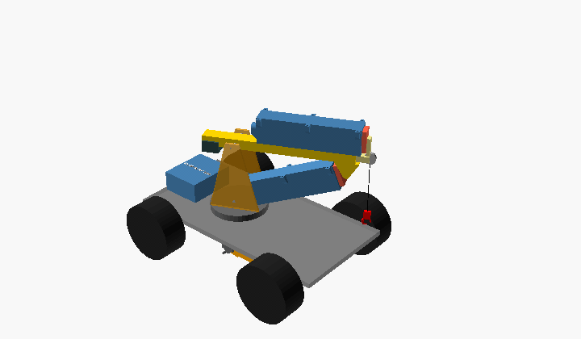

| Boom down, telescope in | Boom up 55°, telescope out |
|---|---|
|  |  |

* **Actuators:** both are the enclosed actuator from `actuator_housing.scad` (132.5 mm
  retracted, 75 mm stroke), included with `use <actuator_housing.scad>`.
* **Lift actuator:** sits between the mast plates and raises the boom through a short
  pushrod to a hanger under the boom. 0 → 55° uses 49.6 mm of the stroke.
* **Telescope actuator:** lies on top of the boom. Its ram pushes a bracket on the front of
  the inner section, for 75 mm of extension (reach 155–230 mm).
* **Console output:** the stroke the lift geometry needs, the reach, the tip‑force ratio
  for the current pose, and the speeds for `step_rate` (full steps/s): at 800 full steps/s
  the actuator runs 20 mm/s, the boom goes 0 → 55° in 2.5 s. Details in the
  [main README](../README.md#speed-how-fast-can-it-move).
* **Animation:** View → Animate (FPS 10, Steps 60) moves both axes together.
* **Outriggers** (`outriggers = true`): two stabilizer legs at the rear, behind the rear axle.
  They swing out beyond the wheels, the pads stay level and come down almost vertically, and
  a pawl locks them. Driven through bowden tubes by a third actuator on the deck. See
  [use case 1](use-cases/README.md#use-case-1-bowden-outriggers--bowden_outriggersscad).

---

## Use cases: bowden drives – [`use-cases/`](use-cases/README.md)

The actuator pushes and pulls a 1.75 mm PETG filament in a PTFE tube, like a 3D printer's
bowden extruder, so it can sit flat on the vehicle while the far end does the work.

| Rear stabilizer legs, out and locked | Crane with both actuators on the deck |
|---|---|
| 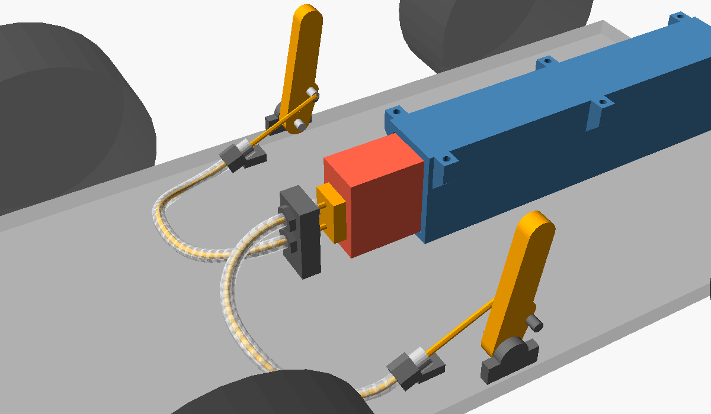 | 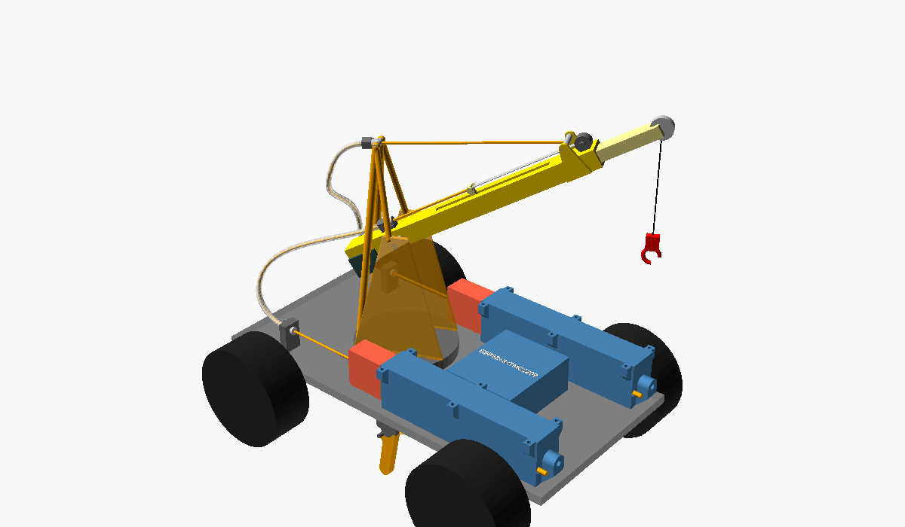 |


| Legs driven by a worm | Legs driven by a pinion between two racks |
|---|---|
| 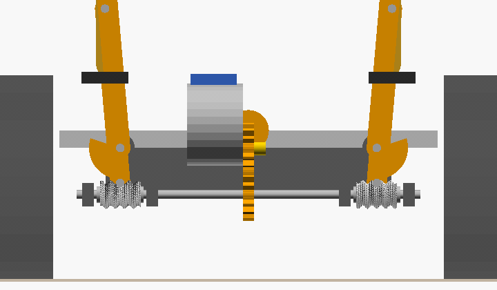 | 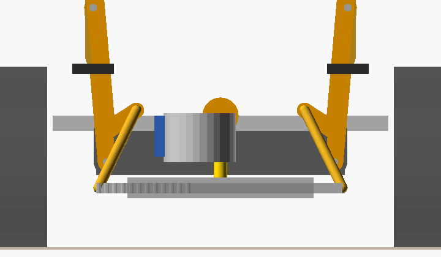 |

[Bowden, worm or rack?](use-cases/README.md#bowden-worm-or-rack)
---

## Enclosed actuator – `actuator_housing.scad`

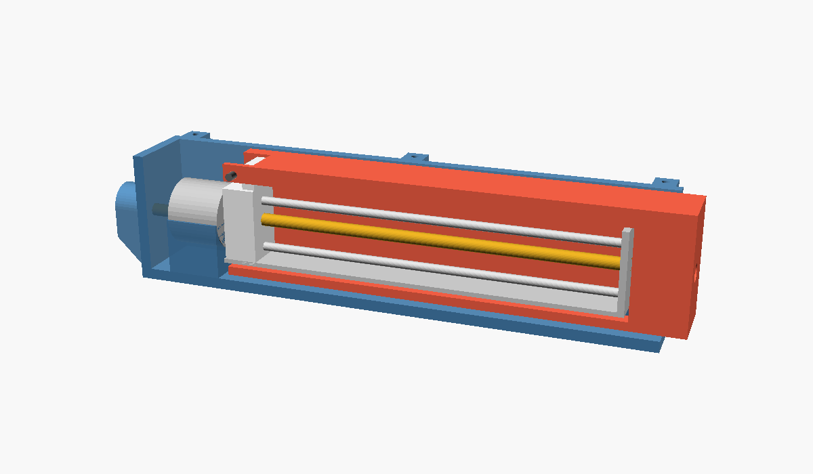

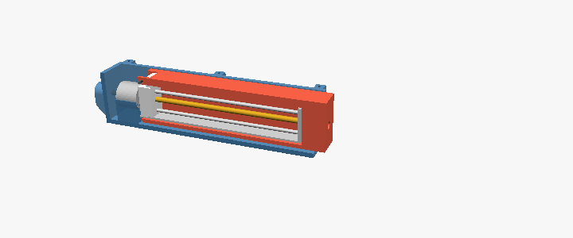

| Side section, ram half out | Fully extended, lid on |
|---|---|
| 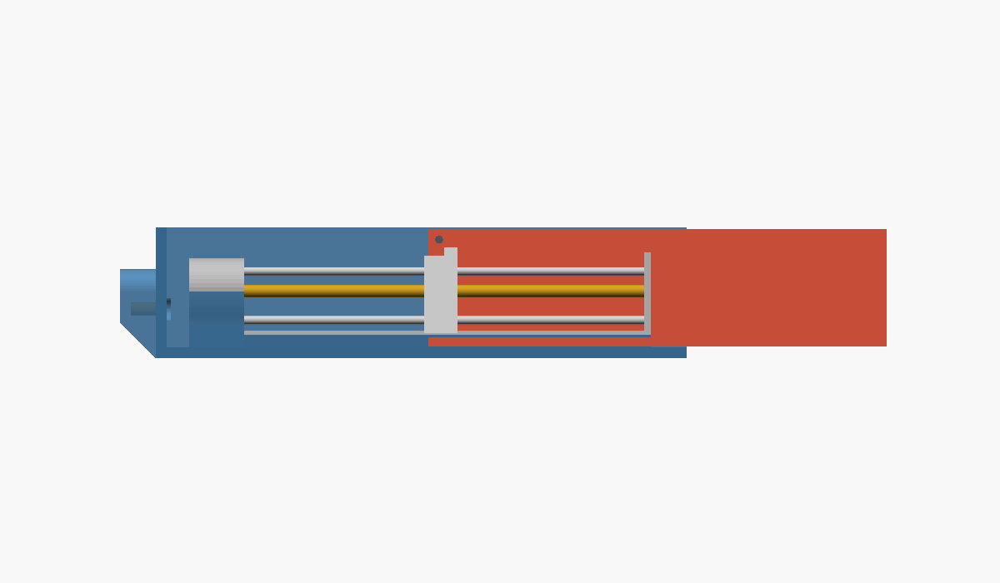 | 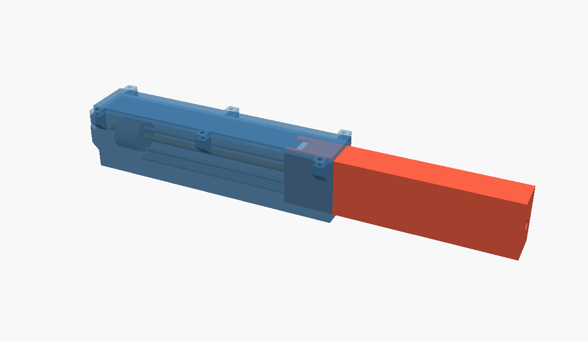 |

* **Tray:** holds the motor in a cradle. The frame sits on a rib along the floor.
* **Ram:** slides around the frame. The slider's tab sits in a slot in the ram's ceiling,
  and a 1.75 mm filament pin behind the tab pulls the ram back in.
* **Mounting:** both ends take an M3 heat‑set insert for RC ball links.
* **Lead screw:** M3, 0.5 mm lead, about 172 turns on 86.6 mm, counted on the
  [listing photo](../docs/actuator_photo.png). That gives the 75 mm stroke.

**Printable parts** (as exported, no supports needed):

| Tray | Lid | Ram |
|---|---|---|
| 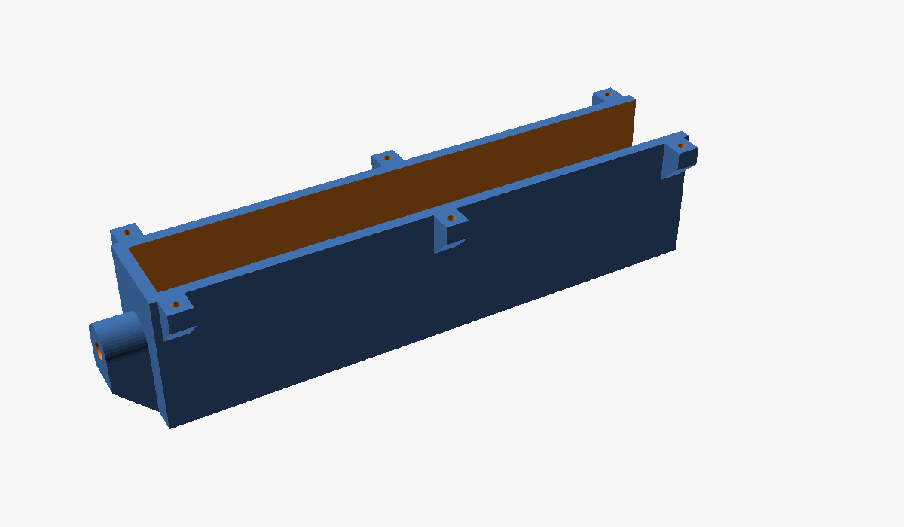 | 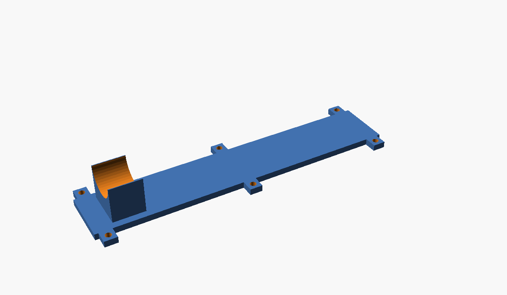 | 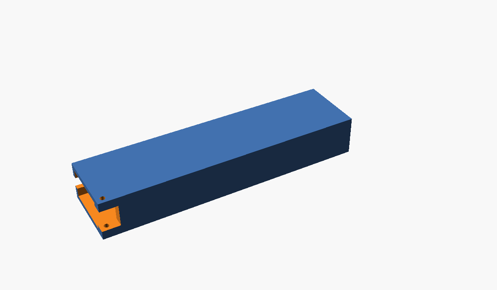 |
| [`actuator_tray.stl`](stl/actuator_tray.stl) | [`actuator_lid.stl`](stl/actuator_lid.stl) | [`actuator_ram.stl`](stl/actuator_ram.stl) |
| floor down | flat side down | on its side, layers along the length |

The parts list, assembly steps and the dimensions to measure are in the
[main README](../README.md#enclosed-actuator-housing-3d-printed).

---

## 28BYJ-48 lead screw actuator – `actuator_28byj.scad`

The cheap variant: a 28BYJ‑48 geared stepper (under €2 with its driver board) turns a T8 lead
screw. It's built like the slider housing (tray + lid + square ram, M3 inserts at both ends,
the same shared pieces from `actuator_common.scad`). How it compares to the other actuators:
[`docs/actuator_comparison.md`](../docs/actuator_comparison.md).

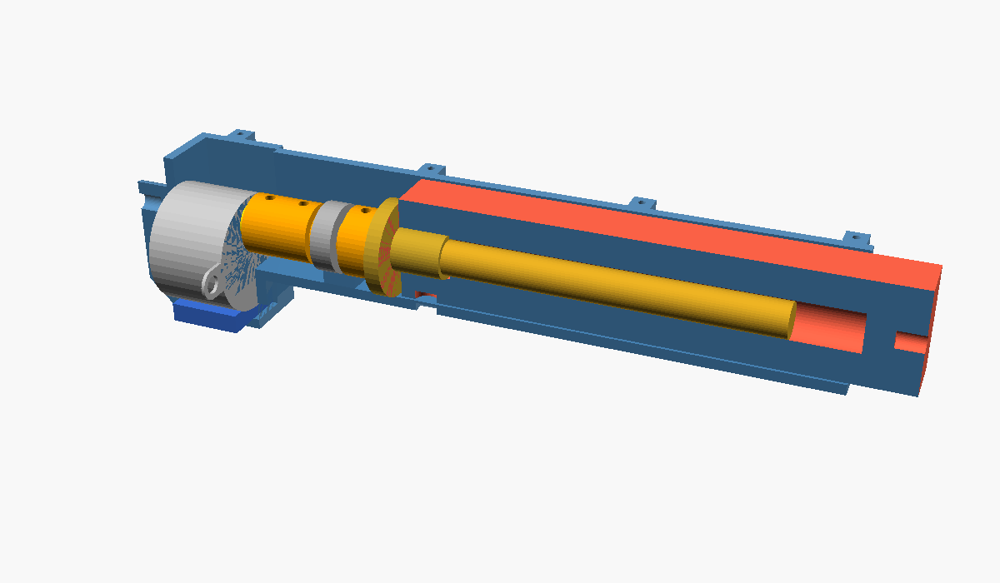

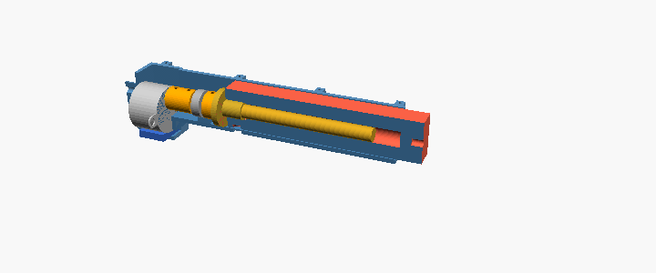

| Side section, ram 40 mm out | Fully extended, lid on |
|---|---|
| 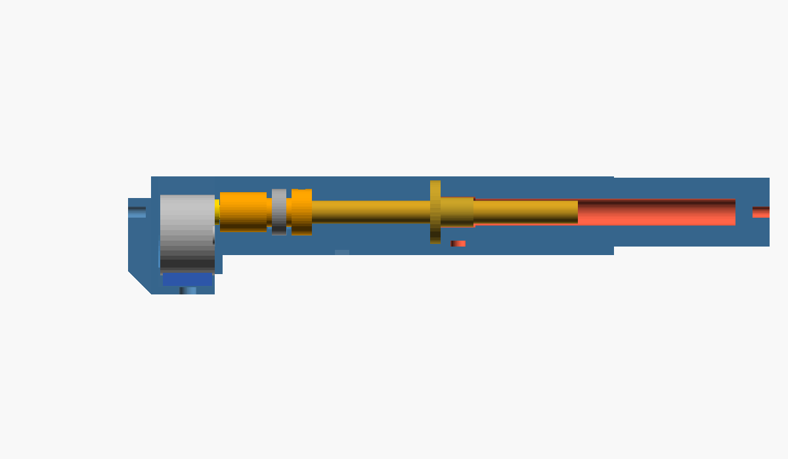 | 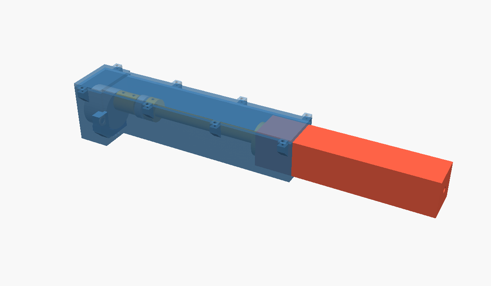 |

* **Drive train:** motor → printed **coupler** (5 mm D‑shaft to 8 mm screw) → **688 bearing**
  → T8 screw. The coupler and a printed **collar** clamp the screw to the bearing's inner ring
  from both sides, so all push and pull loads go into the housing and the motor's plastic
  gearbox only turns the screw.
* **Ram:** square printed bar, the T8 flange nut is screwed to its rear face. The square
  stops it from turning.
* **Motor:** clamped between tray and lid, its mounting ears sit in slots. The shaft is
  8 mm off the motor's centre, so the motor hangs below the screw.
* **Home sensor:** a 5 × 2 mm magnet in the ram's bottom face and a hall sensor (A3144,
  TO‑92) in a pocket under the floor detect the retracted end – with any driver
  (`home_sensor = false` removes both pockets).
* **Size:** 182 mm retracted, 257 mm extended (75 mm stroke), housing 30 × 30 mm, motor
  block 34 mm wide (plus ears), 43 mm high. Stroke, screw lead and all part sizes are
  parameters at the top of the file.
* **Speed and force (console output):** ≈ 2.7 mm/s and ≈ 14 N with a T8×8 screw at 20 rpm;
  T8×2 is 4 × slower and ≈ 4 × stronger. 256 full steps per mm with T8×8.
* **Checked for collisions** at retracted, half and full extension (`part = "collide"`
  shows any overlap).

**Printable parts** (as exported, no supports needed):

| Tray | Lid | Ram | Coupler | Collar |
|---|---|---|---|---|
| 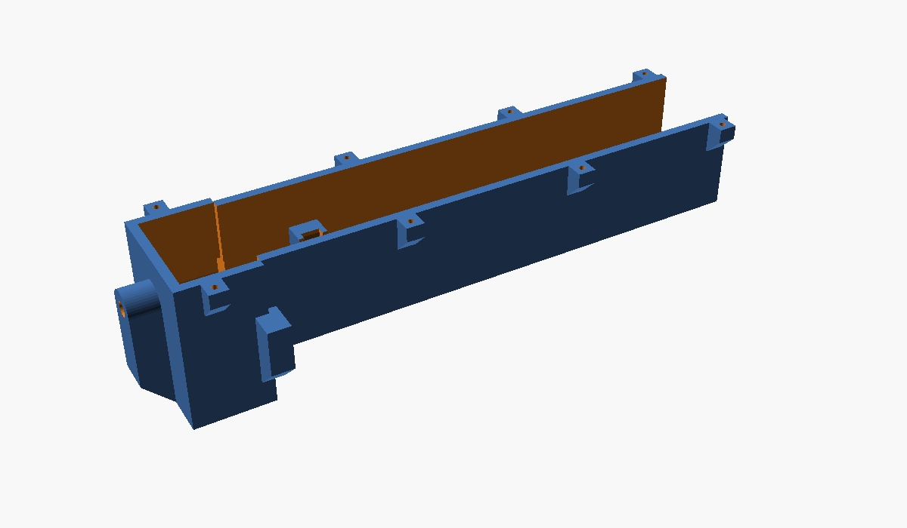 | 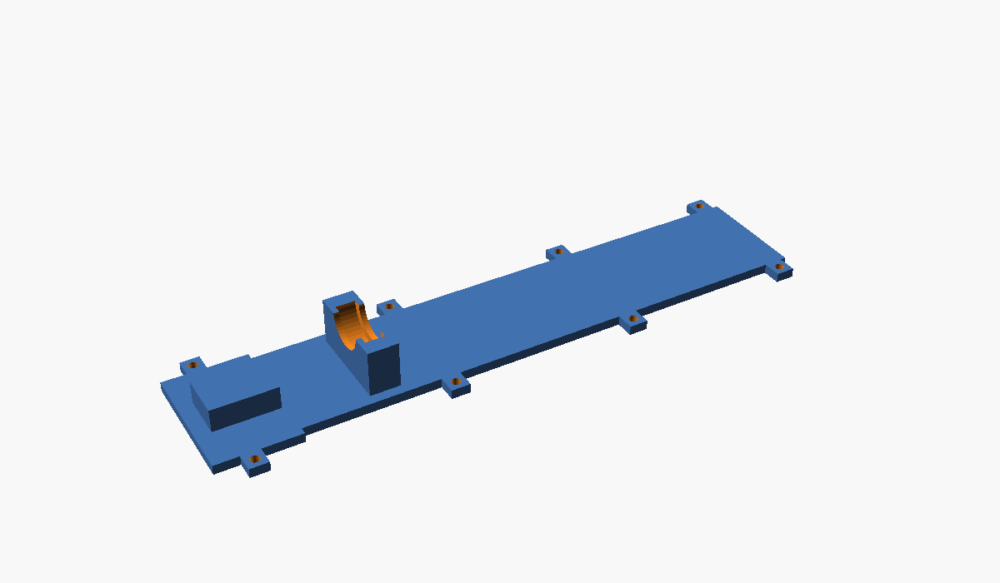 | 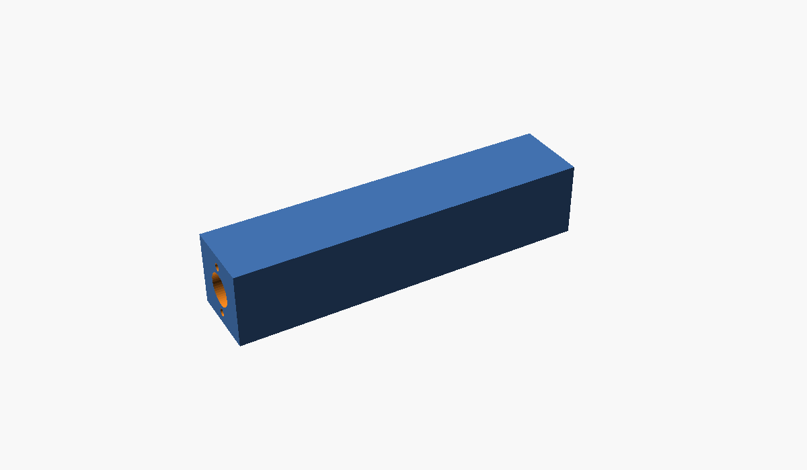 | 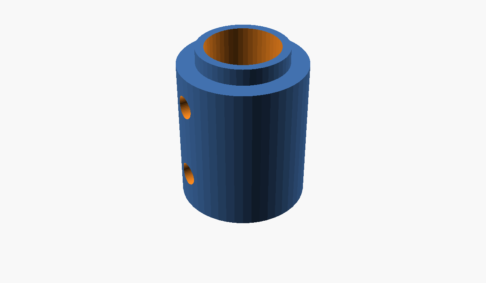 | 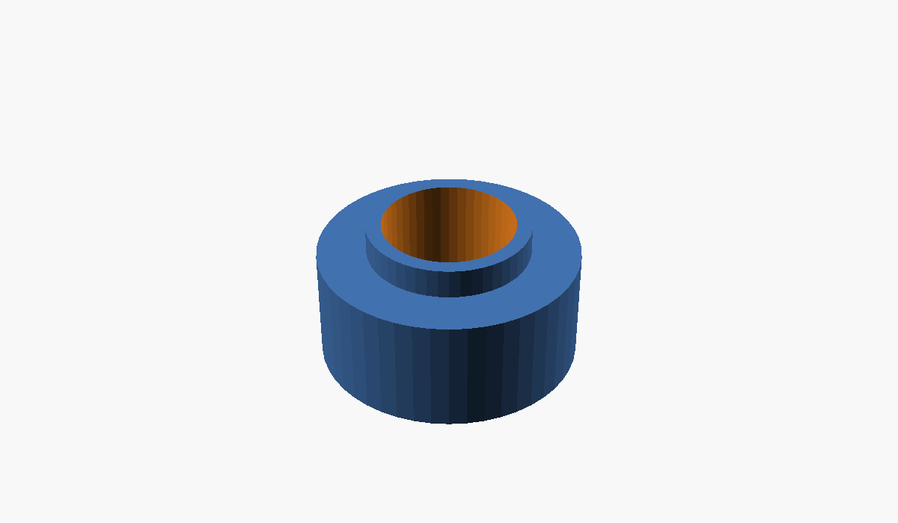 |
| [`.stl`](stl/actuator_28byj_tray.stl) floor down | [`.stl`](stl/actuator_28byj_lid.stl) flat side down | [`.stl`](stl/actuator_28byj_ram.stl) on its side | [`.stl`](stl/actuator_28byj_coupler.stl) motor end down | [`.stl`](stl/actuator_28byj_collar.stl) big face down |

**Parts:**

| Part | Qty |
|---|---|
| 28BYJ‑48, **5 V** version (bipolar mod for the TMC2209, as shipped for the ULN2003 board) | 1 |
| T8 lead screw, lead 8 mm (T8×8) or 2 mm (T8×2), cut to 115 mm | 1 |
| T8 brass flange nut (22 mm flange) | 1 |
| 688ZZ ball bearing, 8 × 16 × 5 mm | 1 |
| M3 grub screws, 4 mm (2 in the coupler, 1 in the collar) | 3 |
| M3 × 8 screws for the nut flange (self‑tapping into the ram) | 2 |
| M2 × 6 self‑tapping screws for the lid | 8 |
| M3 heat‑set inserts (both ends) | 2 |
| Optional: 5 × 2 mm magnet, A3144 hall sensor, 3‑wire lead | 1 each |

**Assembly:**

1. Press in the heat‑set inserts, glue the magnet into the ram, screw the nut flange onto the
   ram's rear face.
2. Coupler onto the motor shaft (grub screw on a flat), screw into the coupler (grub screw),
   bearing onto the screw against the coupler's shoulder, collar against the bearing (grub
   screw). There must be no axial play.
3. Turn the screw into the nut.
4. Into the tray: motor with its ears in the slots, bearing into its seat, ram into the guide.
   Hall sensor into the floor pocket, wires out through the hole under the motor.
5. Lid on, 8 × M2.

**Firmware (TMC2209):** `FULL_STEPS_PER_REV = 2048` (the gearbox is included), `SCREW_LEAD_MM = 8`,
run current about 100 mA. With the ULN2003 board it needs different firmware (4 coil
signals per motor), see the [comparison](../docs/actuator_comparison.md#28byj-48-end-stops-uln2003-boards-and-4-motors).

---

## N20 DC lead screw actuator – `n20_actuator.scad`

The same idea as the enclosed stepper actuator, built around a cheaper DC motor: the
**12GA‑N20 gear motor with an M4 × 100 mm lead screw**
([AliExpress](https://de.aliexpress.com/item/1005006668206749.html), about €5, 3 / 6 / 12 V,
15–1000 RPM). How it compares to the other actuators, and what driving it needs, is in
[`docs/actuator_comparison.md`](../docs/actuator_comparison.md#6-n20-gear-motor-with-m4-lead-screw-in-a-printed-housing).

| Listing photo | Drawing from the listing |
|---|---|
| 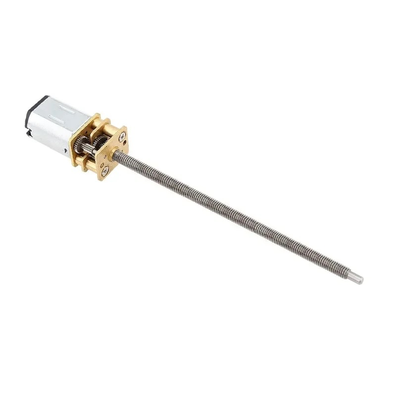 | 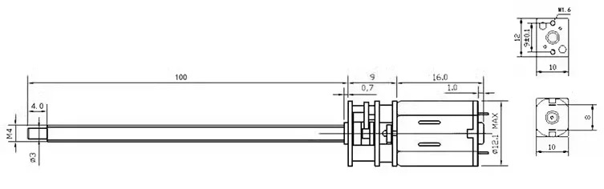 |

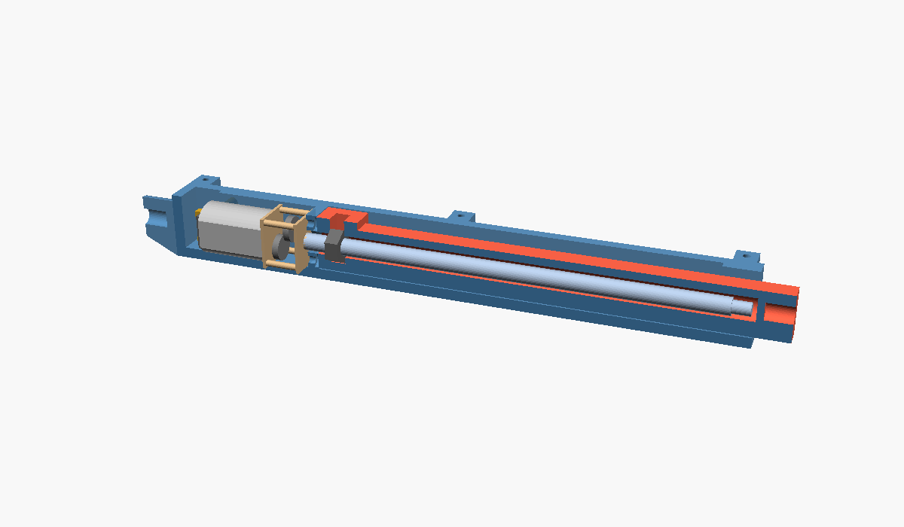

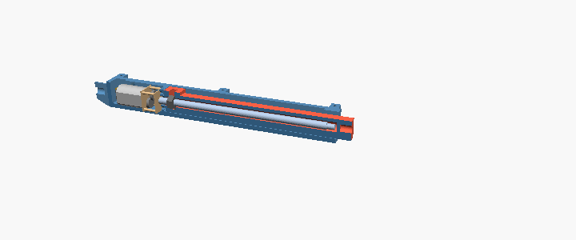

| Bulkhead, nut and piston | Fully extended, lid on |
|---|---|
| 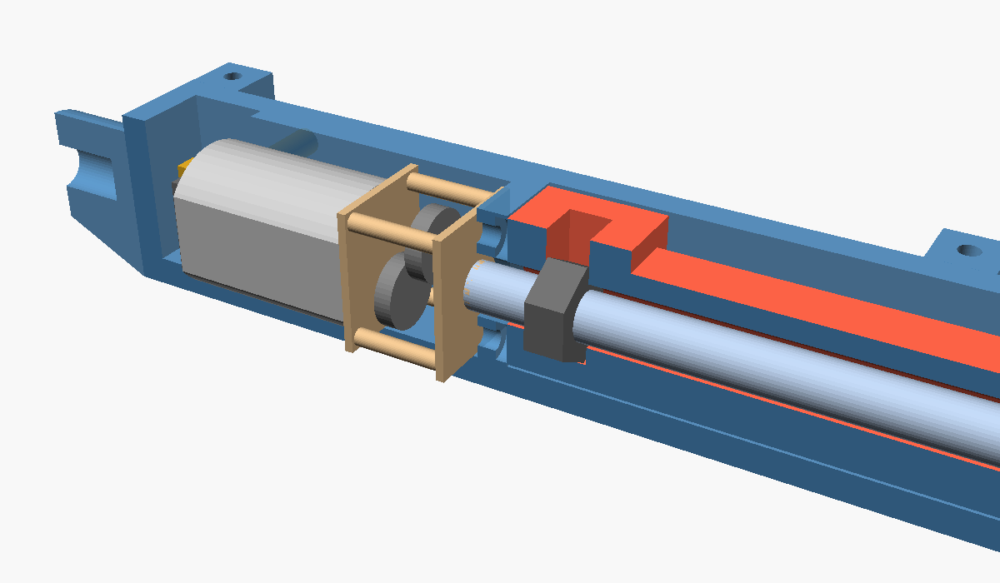 | 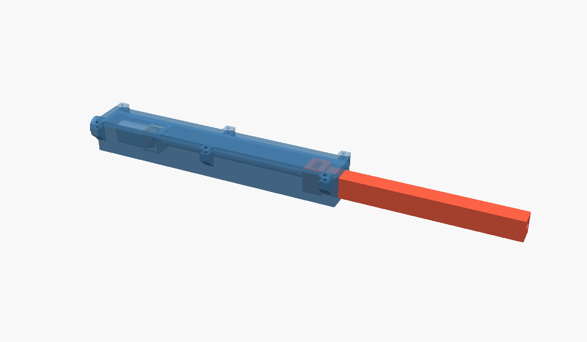 |

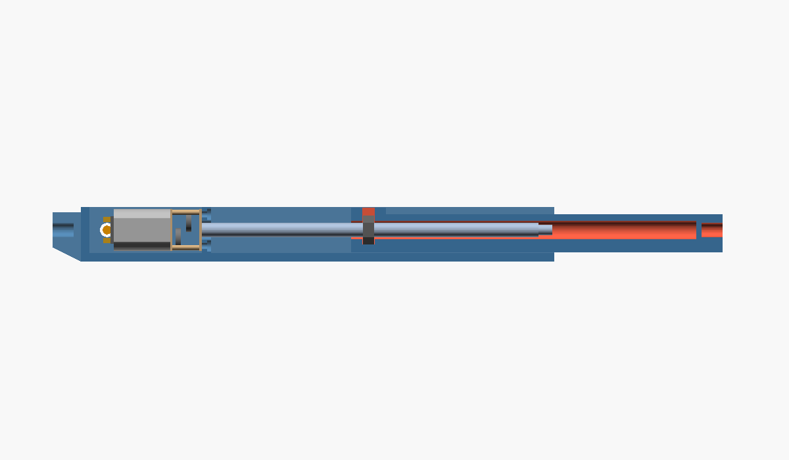

* **Motor, from the drawing:** gearbox 12 × 10 × 9 mm with two M1.6 holes 9 mm apart in the
  front plate, can Ø12.1 mm with 10 mm flats, 16 mm long. Screw 100 mm from the front plate,
  the last 4 mm a plain Ø3 tip.
* **Here the screw turns.** On the stepper slider the actuator brings its own nut and guide.
  This motor has neither, so the ram carries a standard **M4 hex nut** in a slot in its square
  piston. The piston slides in a square channel, so the nut can't turn with the screw.
* **Tray:** motor pocket, a **bulkhead** the gearbox screws to (two M1.6 × 2.5 screws in the
  front plate's own holes, heads counterbored on the ram side), the channel, and a **front
  wall** that guides the ram's rod.
* **Hard stops at both ends:** the piston hits the bulkhead when retracted and the front wall
  at 80 mm. The nut stays 6.8 mm from the end of the thread, so it can't run off. A DC motor
  stalls at the stop, and the driver sees the current rise (see the
  [comparison](../docs/actuator_comparison.md#detecting-the-ends-of-a-dc-actuator-with-current-sensing)).
* **Lid:** a tongue at the front closes the opening above the rod.
* **Size:** 151 mm retracted, 231 mm extended (80 mm stroke), housing 143 × 18 × 18 mm
  without the ears. The screw is a plain threaded rod: cut it shorter, and set `screw_len`
  and `stroke`, for a shorter actuator. The file warns if the nut would run off the thread.
* **Same interface** as `actuator_housing.scad` (`enclosed_actuator()`, `act_retracted()`,
  `act_stroke()`, …), so `crane.scad` can try it by changing its `use <…>` line. With the
  full 100 mm screw it's 12.4 mm too long for the boom lift there (the console warns). Cut
  to `screw_len = 87`, `stroke = 67` it is 138 mm long and fits, still more than the
  49.6 mm the lift needs. The telescope takes the full 80 mm version.

**Printable parts** (as exported, no supports needed):

| Tray | Lid | Ram |
|---|---|---|
| 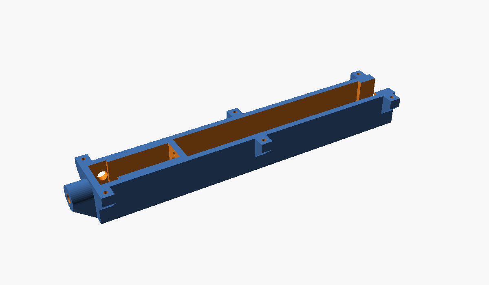 | 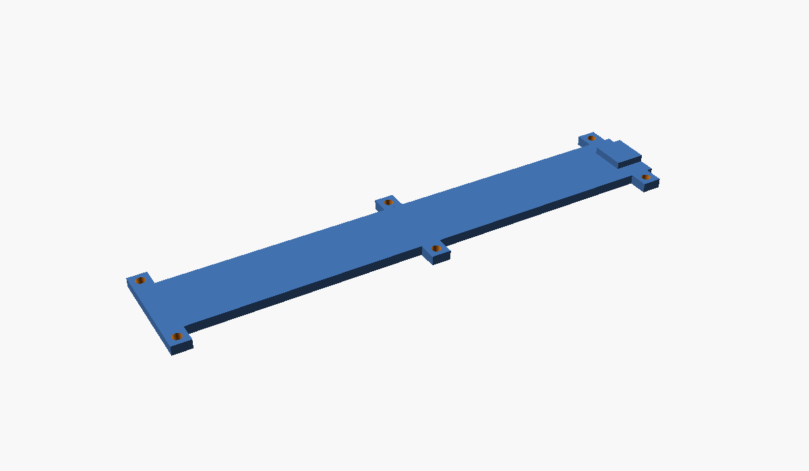 | 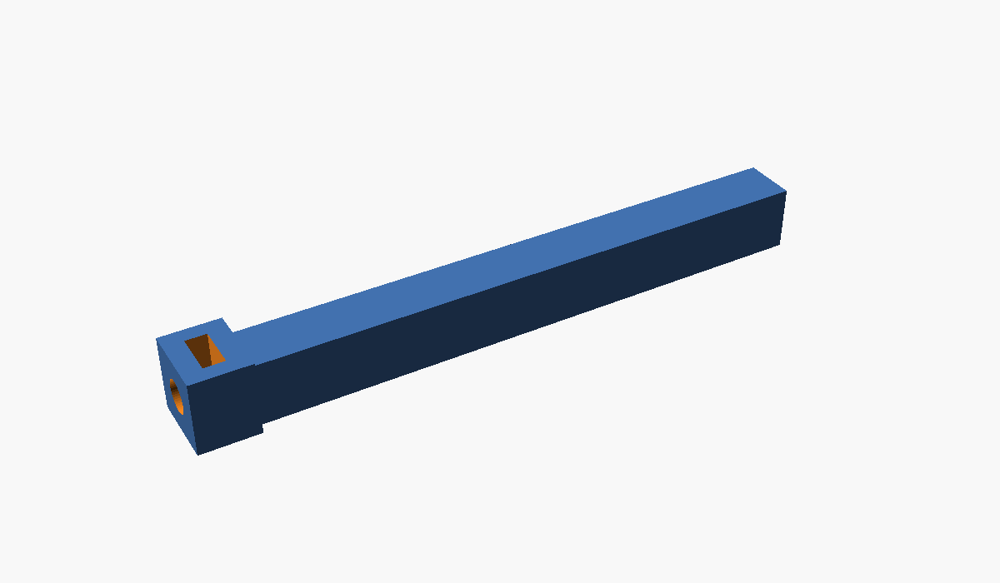 |
| [`n20_tray.stl`](stl/n20_tray.stl) | [`n20_lid.stl`](stl/n20_lid.stl) | [`n20_ram.stl`](stl/n20_ram.stl) |
| floor down | flat side down | standing on its flat floor, nut slot up |

**Other parts:**

| Part | Qty | Notes |
|------|-----|-------|
| 12GA‑N20 motor, M4 × 100 mm screw | 1 | 6 V version for the BEC, see the [comparison](../docs/actuator_comparison.md#6-n20-gear-motor-with-m4-lead-screw-in-a-printed-housing) for the RPM |
| M4 hex nut (DIN 934, 7 mm AF, 3.2 mm) | 1 | brass if you can get it, it runs smoother on the steel screw |
| M1.6 × 2.5 screws | 2 | bulkhead → gearbox. Longer ones reach into the gears |
| M3 heat‑set insert (Ø4 hole, 6 mm deep) | 2 | rear boss + ram nose |
| M2 × 6 self‑tapping screws | 6 | lid → tray ears |

**Assembly:**

1. Melt the heat‑set inserts into the rear boss and the ram nose.
2. Solder the wires to the motor and lead them out through the hole in the side wall.
3. Lay the motor into its pocket and screw the gearbox to the bulkhead with the two M1.6
   screws, from the front through the channel.
4. Drop the nut into the ram's slot. Lay the ram into the channel, rod through the front
   wall, and turn the screw by hand into the nut until the piston is near the bulkhead.
5. Screw on the lid.

> **Measure before printing:** the `(est.)` values at the top of the file (bearing boss,
> solder tabs) aren't on the drawing. Also count the thread: M4 is normally 0.7 mm pitch, but
> the nut drawing in the listing says "M4 × 1". Set `screw_lead` to what you count; it only
> changes the speed numbers. All parts were checked for collisions against the reference
> model at 0, 20, 40, 60 and 80 mm.

---

## DIAG jumper wire – `diag_wire_example.scad`

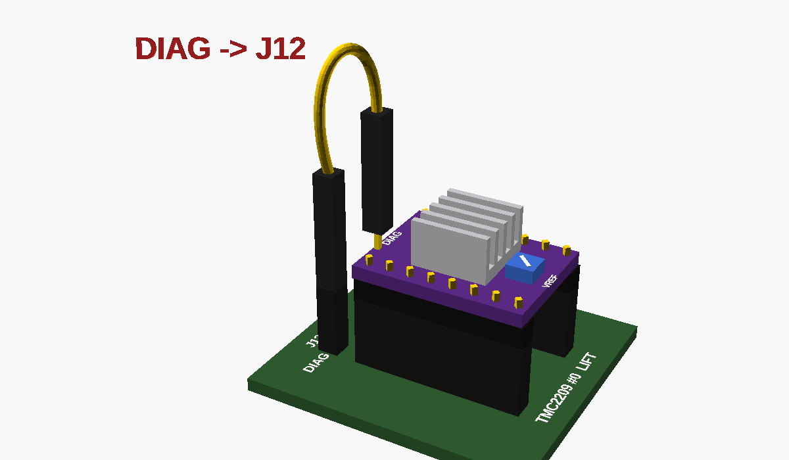

* **What DIAG is:** the TMC2209 pulls its DIAG pin high when the motor stalls. That's how
  homing works without end switches.
* **Why a wire:** DIAG isn't one of the 16 socket pins. On most modules it's a separate pin
  on the board, and its position differs between brands.
* **How:** a short female‑to‑male Dupont jumper connects it to the single socket next to the
  driver:
  * driver #0 (lift) → **J12**
  * driver #1 (telescope) → **J13**

The module here is a generic mock. Its pot (VREF) is unused with UART current control.

---

## Regenerating locally

```bash
./cad/render.sh
```

This needs OpenSCAD 2021.01 or newer, `python3` and `ffmpeg` (for the animated GIFs, which
loop each model's `$t` animation). STL triangles are sorted after export,
so unchanged geometry produces byte‑identical files and git only shows real changes.

To export a single part by hand:

```bash
openscad -o ram.stl -D 'part="ram"' cad/actuator_housing.scad
```
