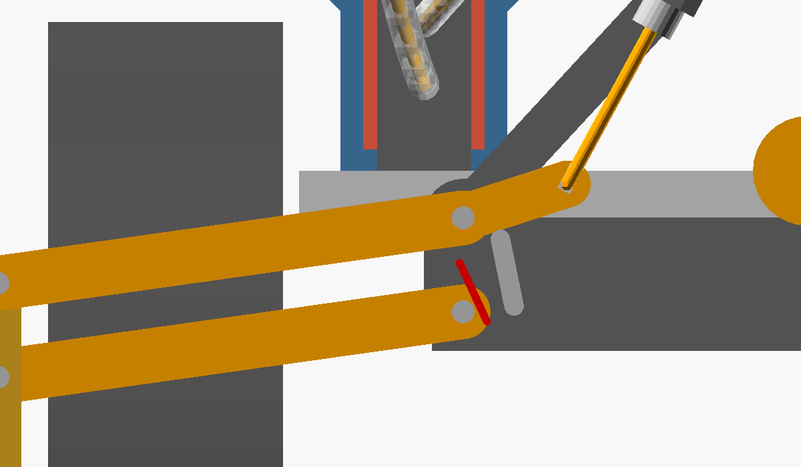

# Use cases: the actuator at a distance (bowden drive)

The actuator doesn't have to sit where the motion is. A 3D printer's bowden extruder pushes
1.75 mm filament through a PTFE tube to the hot end. Here the enclosed actuator does the
same: its ram pushes and pulls a **1.75 mm PETG filament in a PTFE tube (2 mm ID, 4 mm OD)**,
and the far end of the filament does the work. The actuator lies flat somewhere out of the
way, and only a 4 mm tube runs to the mechanism.

Concept models like [`crane.scad`](../crane.scad): rough and not print‑ready, made to check
the geometry. Every file echoes its numbers to the console.

| File | What it is |
|------|------------|
| [`bowden_common.scad`](bowden_common.scad) | Shared pieces: tube along a smooth path with the filament inside, push‑fit fittings, bend radius and buckling checks |
| [`bowden_outriggers.scad`](bowden_outriggers.scad) | Use case 1: two stabilizer legs at the rear that swing out and lock, driven by one actuator on the deck through two tubes. Opened on its own it shows the legs on a see‑through vehicle. [`crane.scad`](../crane.scad) includes it (`outriggers = true`) |
| [`crane_bowden.scad`](crane_bowden.scad) | Use case 2: a copy of `crane.scad` with both crane actuators flat on the deck, working the boom through tubes |

## What a filament in a tube can and can't do

* **Pull:** strong. 1.75 mm PETG breaks at about 100 N.
* **Push inside the tube:** fine. The tube stops it from buckling, which is why bowden
  extruders work.
* **Push outside the tube:** weak. Where the filament leaves the tube it buckles quickly:
  ≈ 27 N at 26 mm free length, ≈ 4 N at 70 mm. So keep the free length short, or only pull.
* **Bends:** at least **20 mm radius**. Tighter, and the PTFE tube kinks and the PETG is bent
  past ≈ 4 % strain every time it moves through the bend. Both files echo the tightest bend
  of every tube and warn below 20 mm (`min_bend()` in `bowden_common.scad`).
* **Friction and stretch:** not modelled. Every bend adds friction, and the tube compresses
  and the filament stretches a little under load. So the far end is less exact than the ram:
  good for end positions, less good for fine positioning.

---

## Use case 1: bowden outriggers – `bowden_outriggers.scad`

Two stabilizer legs at the rear, behind the rear axle, in the style of the
[extended stabilizer legs for LEGO 42082](https://rebrickable.com/mocs/MOC-50496/Sehnclet/extended-stabilizer-legs-42082-rough-terrain-crane/)
rather than a real crane's box outriggers. One actuator on the deck pulls two filaments; each
swings a leg out sideways and down beyond the wheels, where a pawl locks it.

| Folded up (from behind) | Out and locked (from behind) |
|---|---|
|  |  |

*Close‑up from behind: the parallelogram links, the horn with the filament, the pawl (grey)
in the notch of the upper link's hub, and its spring (red).*

* **Where:** the leg plane is 12 mm behind the chassis (x = −112), behind the rear wheels,
  on a beam bolted under the chassis. The pads end up at **±103 mm** from the centre line,
  outside the wheels (which end at ±97 mm), so the stance gets wider, not just stiffer.
* **Parallelogram leg, the pad never rotates:** two 60 mm links on a bracket carry a vertical
  carrier with the foot pad. Folded the links point up (85°) and the legs stand upright behind
  the deck. Deployed they point slightly below horizontal (−8°).
* **The pad comes down, not round:** in the last 10° before locking the pad moves **10.4 mm
  down and only 0.5 mm sideways**. It presses 1 mm into the ground at the end (tyres and links
  take that up).
* **Drive – deploying is a pull:** the filament pulls a 14 mm horn on the upper link. Its tube
  end sits 24 mm inboard of and 24 mm above the upper pivot, clear of the folded leg (checked
  for collisions at five poses). The free filament shortens steadily from 42.7 to 22.4 mm, and
  it never pulls at less than 43° to the horn. **20.3 mm of the actuator's 75 mm** move the
  legs from folded to locked.
* **Lock – a pivoting pawl:** at the end a spring pushes a pawl into a notch in the upper
  link's hub. The ground pushes the leg up, the notch sits on the pawl: **the filament carries
  no load while the crane works**.
* **Release:** the filament's end sits in a 4 mm slot in the horn (lost motion). Pushing it
  back first runs the slot and lifts the pawl over a release wire, then pushes the leg up.
  Pushing is the weak direction (the 42.8 mm of free filament buckle at ≈ 10 N), but folding
  an unloaded leg needs little force.
* **Actuator on the deck:** the enclosed actuator from `actuator_housing.scad` lies on the
  deck at y = 49 mm, beside the electronics box, ram pointing backwards. Its crosshead holds
  both filaments, one above the other.
* **Tubes:** each tube climbs from the deck and comes down into its leg's tube end in a quarter
  circle. The tube to the far leg sweeps across behind the deck and comes in from the inboard
  side. **Tightest bends 20.3 and 22.1 mm** (≥ 20 mm), lengths 136 and 196 mm.
* **In `crane_bowden.scad`** the deck is taken by the two crane actuators, so the outrigger
  actuator sits **on top of the luffing actuator** (`bowden_outriggers(d, y, height)`), with
  the same tube bends.
* **A third actuator** needs a third driver: the carrier boards have two TMC2209, the
  [advanced board](../../pcb/advanced/README.md) has four. The legs only need their two end
  positions, so the cheaper [N20 DC actuator](../README.md#n20-dc-lead-screw-actuator--n20_actuatorscad)
  with current‑sense end detection would do as well.

**In `crane.scad`:** `outriggers = true` (the default) adds the legs, `outrigger_deploy`
poses them (0 = folded, 1 = out and locked). With the animation on, the legs go out at the
start of the cycle and fold in at the end.

---

## Use case 2: bowden crane – `crane_bowden.scad`

`crane.scad` with nothing on the boom but the boom. Both actuators lie flat on the deck and
work the boom through tubes. The filaments only ever pull, so they can't buckle.

| From behind: the tube loop | Boom up 55°, telescope out 60 mm |
|---|---|
|  |  |

* **Actuators:** both flat on the deck, either side of the turntable (y = ±49 mm), rams
  pointing backwards. The electronics box moves to the front of the deck, between them.
* **Luffing, like a crane's luffing rope:** the filament runs from the head of an A‑frame
  (15 mm behind and 60 mm above the boom pivot) to a yoke on the boom (125 mm out, 14 mm
  above it). Pulling raises the boom. When the actuator pays the filament out, the boom's
  weight lowers it.
  * 0 → 55° shortens the line by **56.8 mm** of the 75 mm stroke. Ram out = boom down.
  * Tip force ≈ line tension × 0.34 at 30° with the telescope 25 mm out.
  * The boom can't be pushed down, so the counterweight must stay lighter than the boom:
    the boom always has to hang on its line.
* **Telescope:** a **constant‑force spring** (a tape‑measure spring) on the front of the outer
  section pulls the inner section out by a pin through a slot on top. The filament pulls it
  back in, from a fitting right above the boom pivot, where it hardly moves when the boom
  luffs. Ram out = telescope out, 75 mm, reach 155–230 mm.
* **Tubes:** they bend up behind the actuators and climb behind the mast in a free loop: the
  luffing tube enters the A‑frame head from behind, the telescope tube reaches its fitting
  over the pivot. Lengths: luffing 167–211 mm, telescope 136–165 mm.
  * Tightest bend **≥ 20 mm for boom 0–55° and slew −30° to +30°** (checked at 0°, 30° and
    55° boom angle).
  * At ±45° slew it drops to 17.6–19.6 mm. Further round, the drawn loop folds up (7.7 mm at
    −90°).
  * For more slew the loop needs more tube, or the tubes go through a hollow slewing ring.
* **Speed** at 800 full steps/s: boom 0 → 55° in 2.8 s, telescope 3.75 s, the same
  20 mm/s actuator speed as `crane.scad`.
* **Outriggers:** `outriggers = true` adds use case 1. Its actuator sits on top of the
  luffing actuator, the deck is full.

**Compared with `crane.scad`:** the boom loses two actuators and their wiring, so it's
lighter and slimmer, and the actuators and their wires stay on the vehicle. The price: the
boom can only be pulled, never pushed. The telescope works against a spring. The tubes add
friction, a little stretch, and a service loop that limits the slew.
