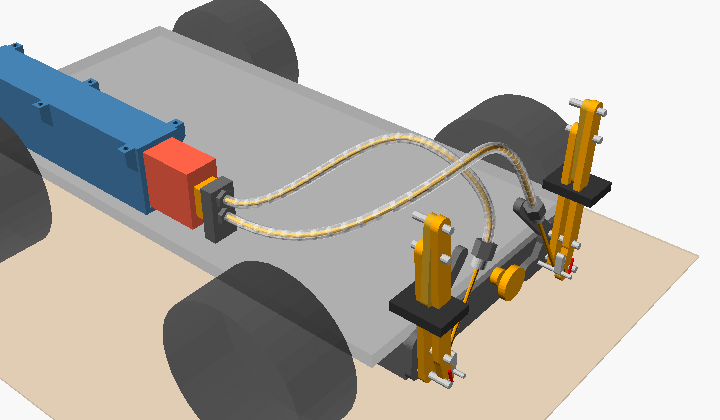
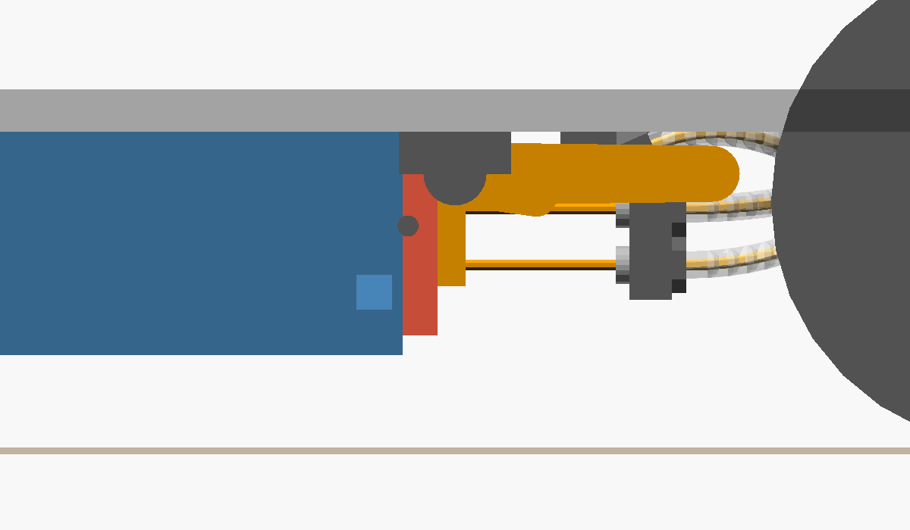
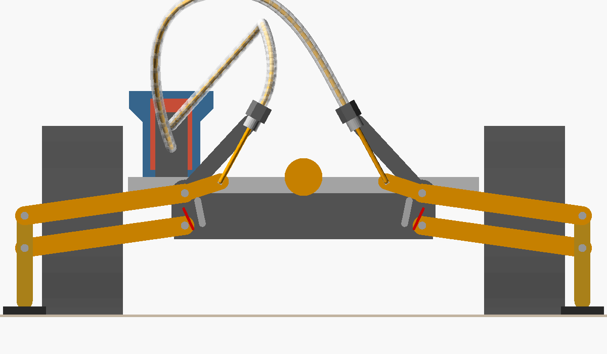
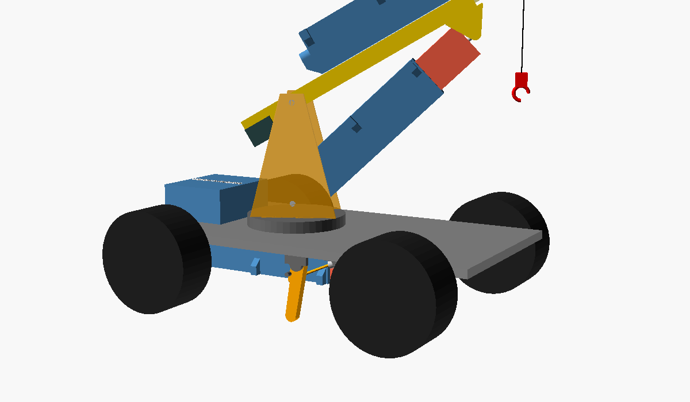
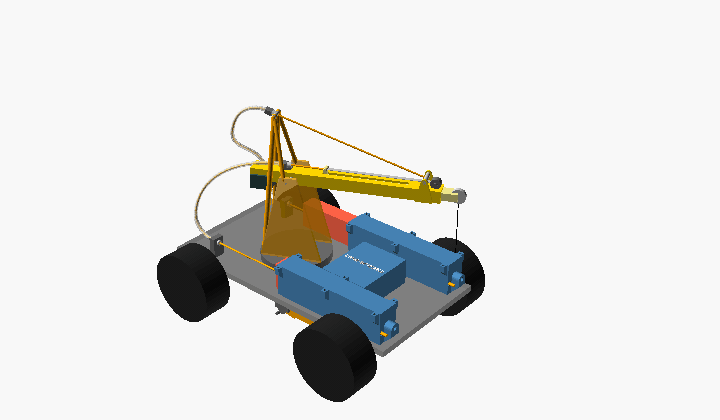
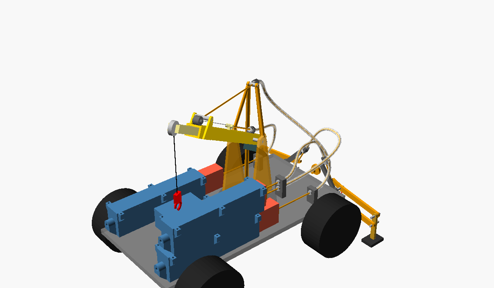
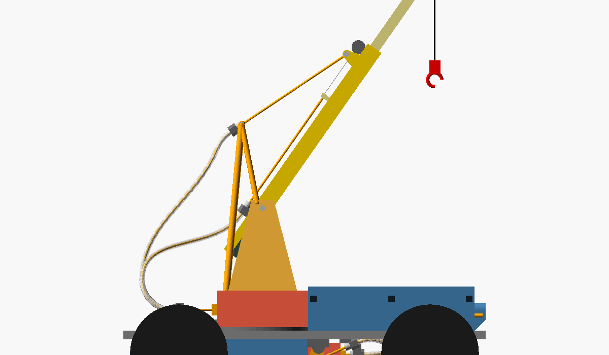

# Use cases: the actuator at a distance (bowden drive)

The actuator doesn't have to sit where the motion is. A 3D printer's bowden extruder pushes
1.75 mm filament through a PTFE tube to the hot end. Here the enclosed actuator does the
same: its ram pushes and pulls a **1.75 mm PETG filament in a PTFE tube (2 mm ID, 4 mm OD)**,
and the far end of the filament does the work. The actuator lies flat somewhere out of the
way, and only a 4 mm tube runs to the mechanism.

Concept models like [`crane.scad`](../crane.scad): rough and not print‑ready, made to check
the geometry. Every file echoes its numbers to the console.

| File | What it is |
|------|------------|
| [`bowden_common.scad`](bowden_common.scad) | Shared pieces: tube along a smooth path with the filament inside, push‑fit fittings, bend radius and buckling checks |
| [`bowden_outriggers.scad`](bowden_outriggers.scad) | Use case 1: two hinged feet under the chassis, driven by one actuator through two tubes. Opened on its own it shows the feet under a see‑through chassis. [`crane.scad`](../crane.scad) includes it (`outriggers = true`) |
| [`crane_bowden.scad`](crane_bowden.scad) | Use case 2: a copy of `crane.scad` with both crane actuators flat on the deck, working the boom through tubes |

## What a filament in a tube can and can't do

* **Pull:** strong. 1.75 mm PETG breaks at about 100 N.
* **Push inside the tube:** fine. The tube stops it from buckling, which is why bowden
  extruders work.
* **Push outside the tube:** weak. Where the filament leaves the tube it buckles quickly:
  ≈ 27 N at 26 mm free length, ≈ 4 N at 70 mm. So keep the free length short, or only pull.
* **Bends:** at least **20 mm radius**. Tighter, and the PTFE tube kinks and the PETG is bent
  past ≈ 4 % strain every time it moves through the bend. Both files echo the tightest bend
  of every tube and warn below 20 mm (`min_bend()` in `bowden_common.scad`).
* **Friction and stretch:** not modelled. Every bend adds friction, and the tube compresses
  and the filament stretches a little under load. So the far end is less exact than the ram:
  good for end positions, less good for fine positioning.

---

## Use case 1: bowden outriggers – `bowden_outriggers.scad`

One actuator, hidden flat under the chassis, pushes two filaments. Each one swings a hinged
foot down to the ground. Pulled back, the feet fold flat under the chassis.

| Folded | Down, locked over centre |
|---|---|
|  |  |

* **Actuator:** the enclosed actuator from `actuator_housing.scad`, its tray floor screwed to
  the underside of the chassis, on the centre line. The feet need **18.4 mm of its 75 mm**.
* **Crosshead:** on the ram nose, it holds both filaments, one above the other. Each filament
  runs in its own tube, which makes a U‑turn in front of the actuator to its foot (tightest
  bend 20.2 mm, 89–91 mm of tube).
* **Foot:** a 36.6 mm arm on a hinge under the chassis edge, 40 mm in front of the
  turntable, between the wheels. Folded, it lies flat under the chassis and points forward.
  The filament pushes a pin on a 12 mm horn, which swings the arm down.
* **Locks over centre:** the arm stops **10° past straight down**, against a stop on its
  bracket. Past vertical, the vehicle's weight pushes the arm further into the stop, not back
  up, so **the filament carries no load while the crane works**. Going over centre lifts the
  vehicle by 0.6 mm.
* **Retracting is a pull:** pulling the arm back over centre is the heavy move, and it puts
  the filament in tension. The push (deploying) only swings the arm and squeezes the tyres
  a little.
* **Free filament at the foot:** 8–26 mm, which buckles at ≈ 27 N. The angle between filament
  and horn never drops below 38°. The filament swings ±16° where it leaves the tube, so the
  fitting there needs a short flexible exit or a swivel.
* **Toes at ±58 mm, inside the wheels** (they start at 67 mm). The feet make the vehicle
  **rigid** – no tyre squish, no rocking on the suspension – rather than wider. For a wider
  stance the arms would have to swing outwards, across the vehicle. That needs tighter tube
  bends than 20 mm, or room that the wheels take up.
* **A third actuator** needs a third driver: the carrier boards have two TMC2209, the
  [advanced board](../../pcb/advanced/README.md) has four. The feet only need their two end
  positions, so the cheaper [N20 DC actuator](../README.md#n20-dc-lead-screw-actuator--n20_actuatorscad)
  with current‑sense end detection would do as well.

**In `crane.scad`:** `outriggers = true` (the default) adds the feet, `outrigger_deploy`
poses them (0 = folded, 1 = down). With the animation on, the feet go down at the start of the
cycle and fold in at the end.

---

## Use case 2: bowden crane – `crane_bowden.scad`

`crane.scad` with nothing on the boom but the boom. Both actuators lie flat on the deck and
work the boom through tubes. The filaments only ever pull, so they can't buckle.

| From behind: the tube loop | Boom up 55°, telescope out 60 mm |
|---|---|
|  |  |

* **Actuators:** both flat on the deck, either side of the turntable (y = ±49 mm), rams
  pointing backwards. The electronics box moves to the front of the deck, between them.
* **Luffing, like a crane's luffing rope:** the filament runs from the head of an A‑frame
  (15 mm behind and 60 mm above the boom pivot) to a yoke on the boom (125 mm out, 14 mm
  above it). Pulling raises the boom. When the actuator pays the filament out, the boom's
  weight lowers it.
  * 0 → 55° shortens the line by **56.8 mm** of the 75 mm stroke. Ram out = boom down.
  * Tip force ≈ line tension × 0.34 at 30° with the telescope 25 mm out.
  * The boom can't be pushed down, so the counterweight must stay lighter than the boom:
    the boom always has to hang on its line.
* **Telescope:** a **constant‑force spring** (a tape‑measure spring) on the front of the outer
  section pulls the inner section out by a pin through a slot on top. The filament pulls it
  back in, from a fitting right above the boom pivot, where it hardly moves when the boom
  luffs. Ram out = telescope out, 75 mm, reach 155–230 mm.
* **Tubes:** they bend up behind the actuators and climb behind the mast in a free loop: the
  luffing tube enters the A‑frame head from behind, the telescope tube reaches its fitting
  over the pivot. Lengths: luffing 167–211 mm, telescope 136–165 mm.
  * Tightest bend **≥ 20 mm for boom 0–55° and slew −30° to +30°** (checked at 0°, 30° and
    55° boom angle).
  * At ±45° slew it drops to 17.6–19.6 mm. Further round, the drawn loop folds up (7.7 mm at
    −90°).
  * For more slew the loop needs more tube, or the tubes go through a hollow slewing ring.
* **Speed** at 800 full steps/s: boom 0 → 55° in 2.8 s, telescope 3.75 s, the same
  20 mm/s actuator speed as `crane.scad`.
* **Outriggers:** `outriggers = true` adds use case 1. Its actuator stays under the chassis,
  out of the way of the deck actuators.

**Compared with `crane.scad`:** the boom loses two actuators and their wiring, so it's
lighter and slimmer, and the actuators and their wires stay on the vehicle. The price: the
boom can only be pulled, never pushed. The telescope works against a spring. The tubes add
friction, a little stretch, and a service loop that limits the slew.
