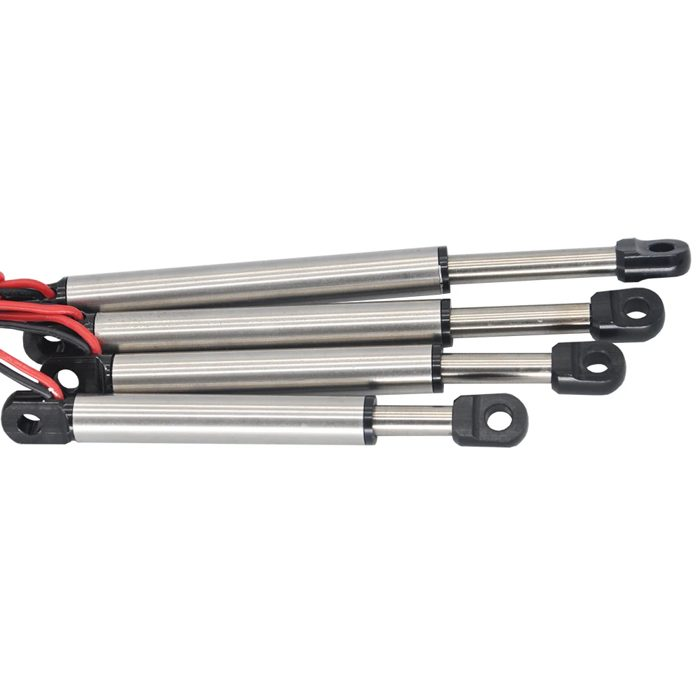
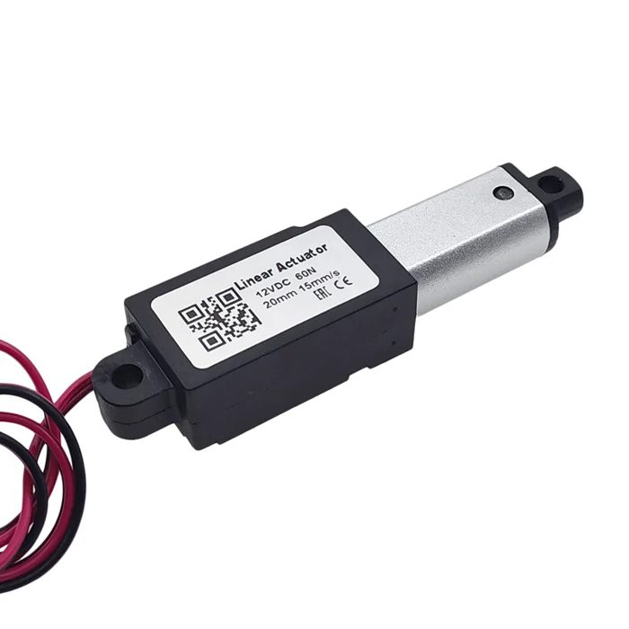
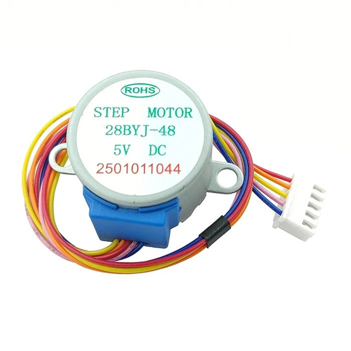
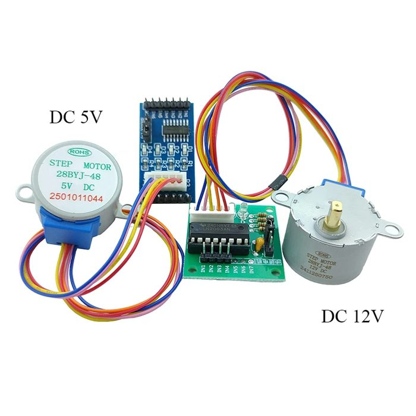
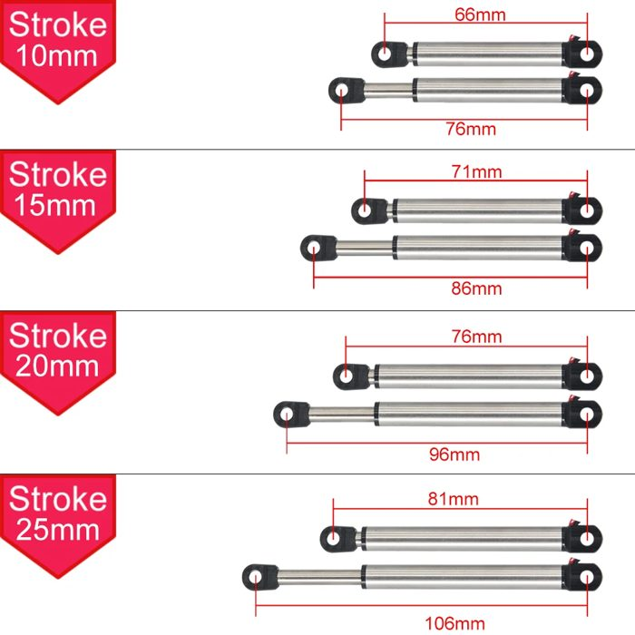
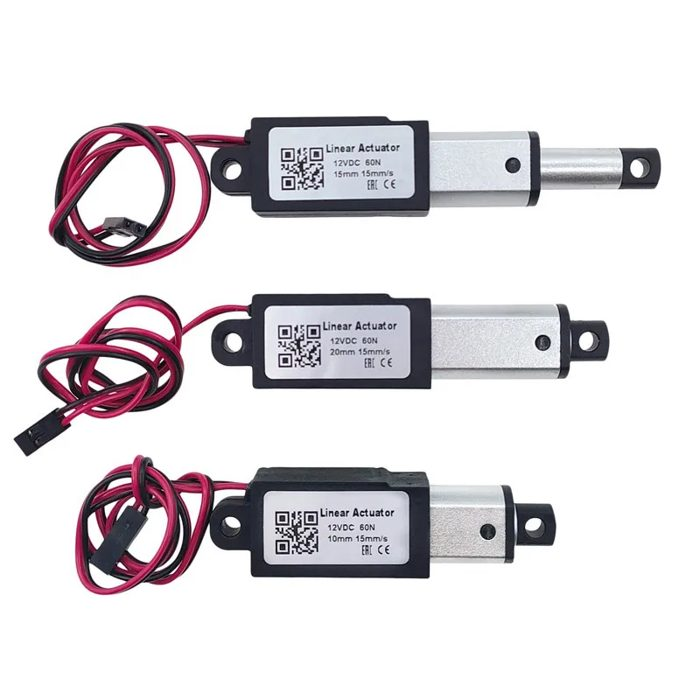

# Linear actuators compared – steppers, DC lead screws and limit switches

The crane currently uses a **mini stepper slider** (see the [main README](../README.md)).
Goal of this comparison: find the cheapest actuator whose **end positions can be detected
without extra switches**, and compare it against actuators that bring their own limit
switches. Options 4 and 5 are a printed lead‑screw actuator around the very cheap 28BYJ‑48
geared stepper, designed in this repo ([`cad/actuator_28byj.scad`](../cad/README.md#28byj-48-lead-screw-actuator--actuator_28byjscad)).

| | 1. Stepper slider (current) | 2. DC micro cylinder, 3–6 V | 3. DC mini actuator, 12 V, limit switches | 4. 28BYJ‑48 + T8 screw, TMC2209 | 5. 28BYJ‑48 + T8 screw, ULN2003 board |
|---|---|---|---|---|---|
| Photo |  |  |  |  |  |
| Listing | [AliExpress](https://de.aliexpress.com/item/1005005779515640.html) | [AliExpress](https://a.aliexpress.com/_EyGPNzg) | [AliExpress, 10–25 mm](https://a.aliexpress.com/_Ez364hU), [AliExpress, 30 mm](https://a.aliexpress.com/_EzM5tL8) | [AliExpress](https://de.aliexpress.com/item/1005008207445943.html) (5 V version) + T8 screw | same, use the ULN2003 board that comes with it |
| Drive | 2‑phase stepper, 18°, M3 lead screw 0.5 mm | brushed DC gear motor + lead screw (2 wires) | brushed DC gear motor + lead screw (2 wires) | geared stepper 1:64, **bipolar mod**, T8 screw | geared stepper 1:64, unipolar as shipped, T8 screw |
| Supply | driver: 4.75–28 V (BEC is fine) | **3–6 V** (BEC 6 V setting) | **12 V** (3S LiPo or boost converter) | BEC, current set by the driver | **BEC 6 V**: the ULN2003 drops ~1 V, so the 5 V motor gets about 5 V |
| Stroke | **75 mm** | 10 / 15 / 20 / 25 mm | 10 / 15 / 20 mm, and 30 mm (second listing) | **75 mm** (any, parametric) | **75 mm** (any, parametric) |
| Length, retracted | 132.5 mm in the [printed housing](../cad/README.md#enclosed-actuator--actuator_housingscad) | 66 / 71 / 76 / 81 mm (pin to pin) | compact gearbox block + rod, see photo | 182 mm (printed housing) | 182 mm (printed housing) |
| Force | small motor, lots of force from the 0.5 mm lead (not measured yet) | **not stated – measure** | **30 / 60 / 100 / 150 N** (versions) | ≈ 14 N with T8×8, ≈ 50 N with T8×2 (estimate) | a bit less than 4 (unipolar) |
| Speed | 15–20 mm/s realistic, see [Speed](../README.md#speed-how-fast-can-it-move) | not stated – measure | **15 mm/s** at 60 N (label); stronger versions are slower | **≈ 2.7 mm/s** (T8×8, 20 rpm) – slow | ≈ 2 mm/s (T8×8, ~15 rpm) – slow |
| Holds position unpowered | yes (lead screw) | probably (lead screw + gearbox) – check | usually (lead screw + gearbox) – check | **yes** (gearbox + screw) | **yes** |
| Position known | **exactly** (step counting) after homing | only at the ends; in between estimated (time) | only at the ends; in between estimated (time) | **exactly** (step counting) | **exactly** (step counting) |
| End detection | StallGuard via DIAG, or hard‑stop homing | **current rise at stall** (this document) | **built‑in limit switches** cut the motor | hall sensor (in the CAD), StallGuard (weak here), hard stop | **hall sensor** (in the CAD) or hard stop – no current info |
| Driver per actuator | TMC2209 StepStick (~€3–4) | small H‑bridge with current sense | any H‑bridge, current sense optional | TMC2209 StepStick | **ULN2003 board, included** |
| ESP pins per actuator | STEP + DIR (+ shared UART, EN, DIAG) | 2 PWM + 1 ADC | 2 PWM | STEP + DIR (+ shared) | 4 outputs (or 3 pins for all via shift registers) + 1 hall input |
| Mounting | needs the 3D printed housing | eyes on both ends, ready to use | eyes on both ends, brackets included | printed housing, M3 inserts both ends | printed housing, M3 inserts both ends |
| Look on a 1:8 model | printed box | **looks like a hydraulic cylinder** | black gearbox block | printed box with a motor bump | printed box with a motor bump |

Prices change too often to list; check the listings. Rough order: the 28BYJ‑48 is by far the
cheapest motor (under €2 with its board); with screw, nut and bearing a 28BYJ actuator is
still the cheapest axis with **exact** position. The DC micro cylinder is cheap but needs a
sense driver, the stepper slider plus driver is in between, the 12 V actuator with limit
switches is the most expensive.

### The DC micro cylinder (option 2)



Lengths from the listing (eye to eye, retracted → extended): 10 mm stroke 66 → 76 mm,
15 mm 71 → 86 mm, 20 mm 76 → 96 mm, 25 mm 81 → 106 mm. The shortest stepper housing is
132.5 mm, so these are far easier to fit in a 1:8 crane, but the stroke is much shorter: the
current boom lift needs 49.6 mm, so the geometry would need a much shorter lever (less tip
force) or a different layout.

### The 12 V actuator with limit switches (option 3)



The label on the 60 N version: *12 VDC, 60 N, 15 mm/s*, stroke 10, 15 or 20 mm. A
[30 mm version](https://a.aliexpress.com/_EzM5tL8) is longer and also has end switches,
30–150 N. In this type of actuator the limit switches usually sit inside, each bridged by a
diode: at an end the switch opens and the motor can only run back the other way. Reversing
the polarity always works, so the controller needs no end detection at all. (How these
particular ones are wired isn't in the listing – check with a multimeter.)

*Photos: from the AliExpress listings linked above.*

---

### The 28BYJ-48 lead screw actuator (options 4 and 5)

| Motor + ULN2003 board (from the listing) | Printed actuator, section ([`actuator_28byj.scad`](../cad/actuator_28byj.scad)) |
|---|---|
|  |  |

The 28BYJ‑48 is a geared stepper (1:64, 2048 full steps per turn). It costs under €2,
including a ULN2003 driver board. On its own it turns, it doesn't push, so the printed
actuator adds a **T8 lead screw**, a **brass flange nut** in a square ram, and a **688 bearing**
that carries all push and pull loads, so the motor's plastic gearbox only has to turn the
screw. Details, parts list and print notes in the [CAD README](../cad/README.md#28byj-48-lead-screw-actuator--actuator_28byjscad).

* **Slow but strong:** about 15–20 rpm at the output. With a T8×8 screw (8 mm per turn) that
  is ≈ 2.7 mm/s and ≈ 14 N; a T8×2 screw gives ≈ 0.7 mm/s and ≈ 50 N (estimates from the
  motor's torque, measure yours). The boom lift (49.6 mm) takes about 19 s with T8×8,
  compared with 2.5 s for the stepper slider. Fine for a slow, realistic crane, a telescope or
  a winch, too slow for anything snappy.
* **Exact position** like the slider: 256 full steps per mm with T8×8.
* **Two ways to drive it:**
  * **Option 4 – TMC2209**, after the [bipolar mod](#28byj-48-and-the-tmc2209-bipolar-mod):
    plugs into the existing boards, current control, quiet. StallGuard is weak on this motor.
  * **Option 5 – the ULN2003 board** it comes with: no mod, no extra driver, but 4 signals
    per motor and no current information at all, see below.
* **Home sensor built into the CAD:** a 5 × 2 mm magnet in the ram and a hall sensor
  (A3144, TO‑92) in a pocket under the floor mark the retracted end. That works with every
  driver.

---

## Detecting the ends of a DC actuator with current sensing

A brushed DC motor draws a roughly constant current while it moves. When the rod reaches the
end of its travel, the motor stalls and the current jumps to the stall current
(≈ supply voltage / winding resistance). Watching for that jump replaces the limit switches.

```
current
  ▲                 stall at the end ──► ┌────────  ← stop here (threshold)
  │  inrush                              │
  │ ┌┐                                   │
  │ │└───────────────────────────────────┘  running current (load dependent)
  └─┴──────────────────────────────────────────► time
    │◄ ignore ►│
      blanking (~100 ms)
```

**Hardware:** an H‑bridge that reports its current.

| Driver | Supply | Current | Current sense | JLCPCB |
|---|---|---|---|---|
| **DRV8876** (recommended) | 4.5–37 V | 3.5 A peak | **IPROPI** pin: a current proportional to the motor current, one resistor → ESP ADC. Built‑in adjustable current limit | [C575551](https://www.lcsc.com/product-detail/C575551.html), extended |
| DRV8874 | 4.5–37 V | 6 A peak | IPROPI, as above | [C1855818](https://www.lcsc.com/product-detail/C1855818.html), extended |
| DRV8871 | 6.5–45 V | 3.6 A peak | no sense output, current limit only (add an INA180 + shunt) | [C75864](https://www.lcsc.com/product-detail/C75864.html), extended |
| DRV8833 / TB6612 modules | 2.7–10.8 V / 4.5–13.5 V | 1.5 A / 1.2 A per channel | DRV8833: shunt on its ISEN pin → ADC (small signal) / TB6612: none | modules from AliExpress |

The DRV8876 suits both DC options: its 4.5 V minimum works from the 6 V BEC, and its 37 V
maximum covers 12 V. Its **current limit** can be set just above the running current. The
motor then never pushes the end stop with full stall force, which protects the small plastic
gears when it hits the end on every homing run.

**Firmware logic, per axis:**

1. Drive with PWM. Ignore the current for the first ~100 ms (inrush).
2. Average the current (e.g. over 10 ms). If it stays above the threshold (about
   2 × running current) for ~30 ms → **end reached**, stop, remember which end.
3. **Timeout** as a fallback: if no stall is seen after the full‑stroke time + 50 %, stop
   anyway.
4. **Position in between:** estimate from the run time, using the speed measured during a
   full run from end to end at power‑up. Every time an end is hit, the estimate is corrected.
5. Better position, still without sensors: **ripple counting**. Each commutator segment
   change makes a small dip in the motor current. Counting them gives motor revolutions,
   and with the gear and screw ratio, the rod position. This needs a cleaner current signal
   (op‑amp band‑pass) and is a project of its own.

**Limits of the method:**

* **A heavy load looks like an end.** If the boom is overloaded, the current rises the same
  way. Treat it as "can't go further" and stop either way, which is the right reaction
  for a crane.
* **Threshold depends on the voltage.** With the BEC on 6 V or 7.4 V, the running and stall
  currents change. Measure both once and keep the threshold as a [web setting](../README.md#web-settings-page).
* **Wear:** with a hard current limit it's gentle, but every homing still presses the
  mechanical end stop.

---

## 28BYJ-48: end stops, ULN2003 boards and 4 motors

### 28BYJ-48 and the TMC2209: bipolar mod

The 28BYJ‑48 is unipolar (5 wires, red = common center tap). The TMC2209 needs two separate
coils: lift the blue cover, **cut the trace that joins the red wire to both coils**, leave red
unconnected. Then orange + pink is one coil and yellow + blue the other (check with a
multimeter: each pair reads twice the listed coil resistance, no connection between pairs).
Use the **5 V version** and set the run current to about 100 mA; with ~100 Ω per coil the
BEC voltage limits it anyway.

### End stop detection with the ULN2003

The ULN2003 is just 7 transistor switches: it puts the full supply voltage on a coil, with no
current control and no feedback. So the motor can't tell us where the end is:

| Method | Works with ULN2003? | Notes |
|---|---|---|
| **Hall sensor + magnet** | ✅ **recommended** | Already in the CAD: magnet in the ram, A3144 under the floor. Exact, no wear, ~€0.20. One per actuator, for the retracted (home) end; the other end comes from step counting |
| Micro switch | ✅ | Works the same way, needs room and a lever |
| Hard‑stop homing | ⚠️ | Drive the full stroke + margin towards home and let the motor skip steps at the stop. The 28BYJ is weak enough that nothing breaks, but it rattles, and with a lead screw the nut jams a little. PWM on the IN pins lowers the coil current for the homing run |
| Current sensing | ❌ | A stepper on a constant‑voltage driver draws almost the same current whether it turns or stalls (at these low speeds there's hardly any back‑EMF). Nothing to detect |
| StallGuard | ❌ | Only exists inside TMC drivers |

### Integrating 4 ULN2003 boards

Each ULN2003 board needs **4 inputs** (IN1–IN4), **+5–12 V** and **GND**; it takes 3.3 V logic
directly. 4 motors = 16 signals, which is too many for direct GPIOs on the boards we have.

| Way | ESP pins for 4 motors | Notes |
|---|---|---|
| **2 × 74HC595 shift registers** (recommended) | **3** (data, clock, latch) | One SPI write updates all 16 outputs in a few µs, every step. 74HC595D is a JLCPCB basic part ([C5947](https://www.lcsc.com/product-detail/C5947.html)) |
| Direct GPIOs | 16 | The advanced board's TMC pins (STEP/DIR/EN/UART/DIAG) free up 15 – not quite enough |
| PCA9685 outputs set fully on/off | 0 extra | Possible, but every step needs an I²C write (~1.6 ms for 16 channels), so ~600 steps/s for all motors together – just about enough for the slow 28BYJ, wastes the servo outputs |
| MCP23017 I/O expander | 2 (I²C) | Like the PCA9685: works, I²C limits the step rate |

**Power:** a 28BYJ‑48 draws 0.15–0.25 A at 5 V (two coils on), 4 motors up to 1 A. Feed the
boards from the **BEC on its 6 V setting**: the ULN2003 drops about 1 V, so the 5 V motors
get roughly 5 V. On 7.4 V they run hotter; switch all coils off when a motor stands still
(the gearbox and the lead screw hold the position anyway).

### Drivers at the motors: a small hub board

Your idea, and it fits the ULN2003 well: **leave the ULN2003 board at the motor** (it can sit on
the actuator housing) and run one thin cable per actuator to a small central board.

```
                 7-wire cable per actuator (e.g. JST-XH 7 or Dupont)
  ┌──────────────────────┐   +V  GND  IN1  IN2  IN3  IN4  HOME
  │ hub board            │══════════════════════════════════════► ULN2003 board ──► 28BYJ-48
  │  ESP32-C3 SuperMini  │══════════════════════════════════════► ULN2003 board ──► 28BYJ-48
  │  2 × 74HC595         │══════════════════════════════════════► ULN2003 board ──► 28BYJ-48
  │  RC inputs / CRSF    │══════════════════════════════════════► ULN2003 board ──► 28BYJ-48
  │  BEC in (6 V)        │                     HOME ◄── hall sensor in each actuator housing
  └──────────────────────┘
```

* **ESP32‑C3 pins:** 3 for the shift registers, 4 hall inputs, 4 RC inputs (or one CRSF/SBUS
  input) – 11 of the SuperMini's 13. WiFi web settings as now.
* **Board:** the SuperMini in sockets, 2 × 74HC595, 4 output connectors, RC headers, BEC input.
  No driver modules, no regulators beyond the SuperMini's own: about **50 × 40 mm**.
* **Even smaller per‑motor nodes** are possible later: a tiny board with a ULN2003ADR
  ([C7512](https://www.lcsc.com/product-detail/C7512.html), basic) and a 74HC595 per actuator,
  daisy‑chained on a 5‑wire bus. More custom boards, fewer wires through the crane.

---

## What our boards need to drive them

The current boards are built around TMC2209 StepStick sockets, and those only drive steppers.
The DC actuators need an **H‑bridge per actuator** instead.

### Requirements per actuator type

| | 1. Stepper slider | 2. DC micro cylinder 3–6 V | 3. DC 12 V with limit switches |
|---|---|---|---|
| Driver | TMC2209 StepStick | H‑bridge **with current sense** (DRV8876, DRV8874) | any H‑bridge (DRV8871, DRV8876, TB6612, …) |
| Motor supply | 4.75–28 V, BEC is fine | **6 V max.**: BEC on 6 V directly; on 7.4 V limit the PWM to about 80 % | **12 V**: 3S LiPo, or a boost converter; runs slower and weaker on 6–7.4 V |
| ESP pins | STEP + DIR, shared UART/EN/DIAG | 2 PWM (or PH + EN) + **1 ADC** | 2 PWM (or PH + EN) |
| End detection | StallGuard / hard stop | current threshold in firmware | none needed (switches); current sense optional for obstacles |
| Firmware | as now | new "DC axis": PWM, current watch, time‑based position | new "DC axis": PWM, time‑based position |

### Current sense with the DRV8876

The DRV8876 has an **IPROPI** output: a small current proportional to the motor current
(about 1000 µA per A, see the datasheet). One resistor from IPROPI to GND turns it into a
voltage for an ESP32 ADC pin:

```
             DRV8876
 ESP PWM ──► PH/EN        OUT1 ──► motor
 ESP PWM ──► EN/IN2       OUT2 ──►
            IPROPI ──┬──► ESP ADC (with ~10 nF to GND)
                     R_IPROPI ≈ 2.2 kΩ → about 2.2 V at 1 A
            VREF ◄── divider from 3V3: sets the built-in current limit
            VM   ◄── motor supply (BEC or battery)
```

* Pick `R_IPROPI` so the expected stall current lands at about 2–2.5 V, inside the ESP32's
  ADC range.
* **VREF** sets the driver's own current limit (I = VREF / (R_IPROPI × 1000 µA/A)). Set it
  just above the running current: gentle end stops, no cooked motor if the firmware hangs.
* **Modules instead of chips:** Pololu sells the DRV8876 and DRV8874 as small carrier boards.
  If the current‑sense output is on a pin (check the board you buy), those could plug into
  sockets, the same way the StepSticks do now.

### What each of our boards would need

| Board | Stepper slider | DC micro cylinder (2) | DC 12 V with limit switches (3) |
|---|---|---|---|
| **Small carrier** (ESP32‑C3, THT/SMD) | ✅ 2 axes, as is | ❌ new variant: 2 × DRV8876 instead of the StepSticks. The C3 has its ADC only on GPIO0–4, so the pin map changes: per axis 2 PWM + 1 ADC (GPIO0–4) | ❌ new variant as for (2), ADC not needed. 12 V supply needs a battery input again |
| **Advanced board** (ESP32‑S3, single or stack) | ✅ 4 axes, as is | ❌ new variant: 4 DC driver sockets instead of the StepSticks, IPROPI on ADC1 pins (GPIO4–7, freed from STEP/DIR). Note that **ADC2 doesn't work while WiFi is on**, so the ADC pins must come from ADC1 (GPIO1–10) | ⚠️ VM can already come from a **3S battery via JP9**. Needs H‑bridges: a DC driver variant as for (2), or the trick below |
| **No board at all** | – | ❌ an RC brushed ESC has no end detection, so it would stall at the ends | ✅ **mini brushed ESC** (forward/reverse) per actuator, straight on a receiver channel. The limit switches stop it at the ends |

**The ESC trick works with the advanced board too:** its 16 PCA9685 outputs are ordinary servo
signals. Option 3 actuators with mini brushed ESCs can hang on spare outputs, with no new
board needed, as long as they get 12 V (or run slower on 6–7.4 V).

**Driving the H‑bridges from the PCA9685:** a DC driver board could take its PWM signals from
the PCA9685 instead of the ESP, which saves up to 8 ESP pins for 4 axes. The PCA9685's PWM
is slow (max. about 1.5 kHz), which is audible but fine for small gear motors. Only the
current‑sense ADC inputs need ESP pins.

### Shopping list for a DC version (per axis)

| Part | Option 2 | Option 3 |
|---|---|---|
| H‑bridge | DRV8876 (chip, LCSC [C575551](https://www.lcsc.com/product-detail/C575551.html), or Pololu carrier) | DRV8871 / DRV8876, or a mini brushed RC ESC |
| R_IPROPI, ADC filter cap | 2.2 kΩ, 10 nF | – (optional) |
| VREF divider | 2 resistors | – |
| Bulk capacitor on VM | 47–100 µF | 100 µF |
| Supply | BEC 6 V | 3S LiPo or 6 → 12 V boost converter (≥ 2 A input for a 60 N actuator, check its current) |

---

## Summary

| | Stepper slider | DC micro cylinder + current sense | DC 12 V with limit switches | 28BYJ + T8, TMC2209 | 28BYJ + T8, ULN2003 |
|---|---|---|---|---|---|
| Position accuracy | **exact** | estimated between the ends | estimated between the ends | **exact** | **exact** |
| End detection | StallGuard / hard stop | current rise, needs a sense driver and tuning | **built in**, no tuning | hall sensor (CAD), hard stop | hall sensor (CAD), hard stop |
| Cost per axis | medium | low | highest | **lowest** (plus screw and nut) | **lowest**, driver included |
| Speed | **15–20 mm/s** | measure | 15 mm/s | ≈ 2.7 mm/s | ≈ 2 mm/s |
| Fits 1:8 | needs a housing, 132 mm long | **small, looks right** | compact, 12 V needed | housing 182 mm, motor bump | housing 182 mm, motor bump |
| Stroke | **75 mm** | 10–25 mm | 10–30 mm | any (printed) | any (printed) |
| Force | good (measure) | unknown, probably low – measure | **specified, up to 150 N** | ≈ 14–50 N (screw lead) | a bit less |
| Board support today | **yes** (all boards) | no – needs a DC driver variant | via mini brushed ESCs on PCA9685 outputs; otherwise a DC driver variant | **yes**, after the bipolar mod | no – needs the hub board |

**Recommendation for the next step:** buy one DC micro cylinder (20 or 25 mm), one 12 V
actuator (60 N, 20 mm) and two 28BYJ‑48 with a T8×8 screw, and measure:

| Test | How |
|---|---|
| Running and stall current at 6 V / 7.4 V (12 V for option 3) | lab supply or a USB power meter, block the rod |
| Speed | time a full stroke |
| Force | push against a kitchen or luggage scale until it stalls |
| Self‑locking | load the rod with the motor unpowered |
| End stop survives | 100 homing runs at the planned current limit |
| Option 3 at 7.4 V | does it still move and switch off at the ends (slower, less force)? |
| 28BYJ actuator | speed and force with ULN2003 at 6 V and TMC2209 (bipolar mod); does StallGuard give a usable signal; does the hall sensor switch reliably |

With those numbers we can decide whether a DC driver variant of the advanced board makes
sense, as described in [What our boards need](#what-our-boards-need-to-drive-them).
