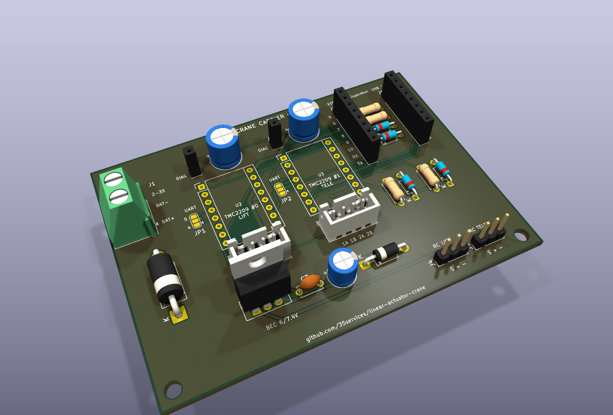
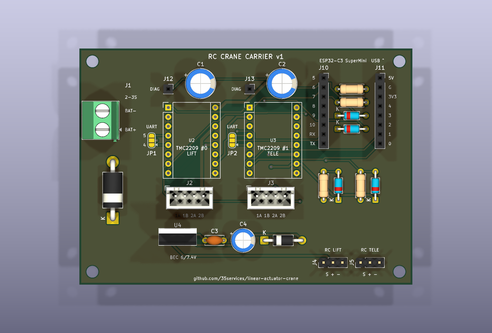
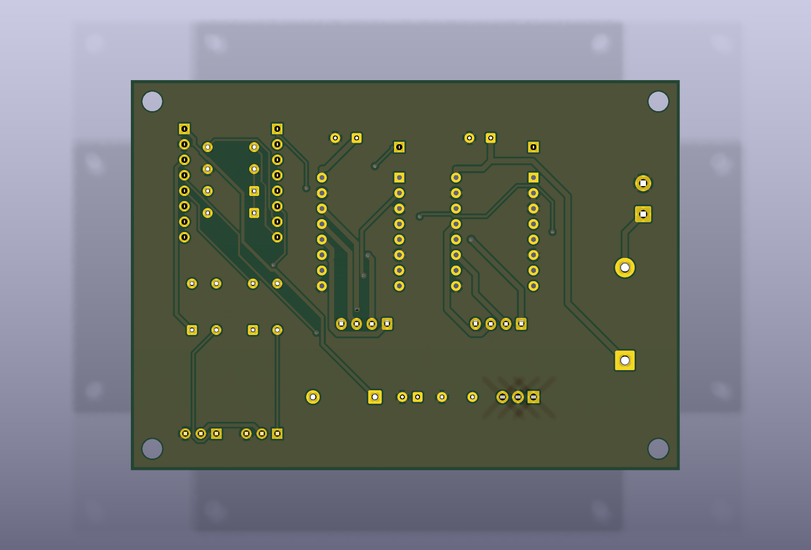
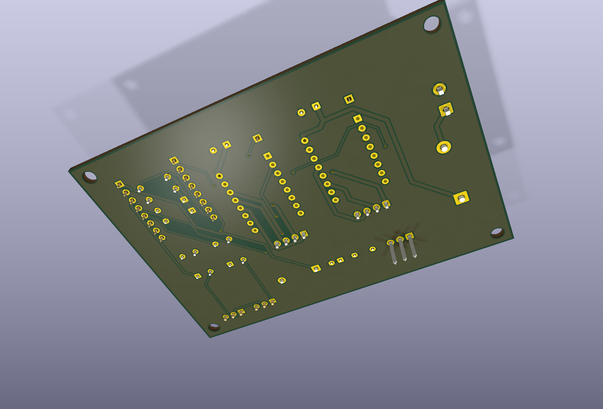
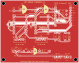
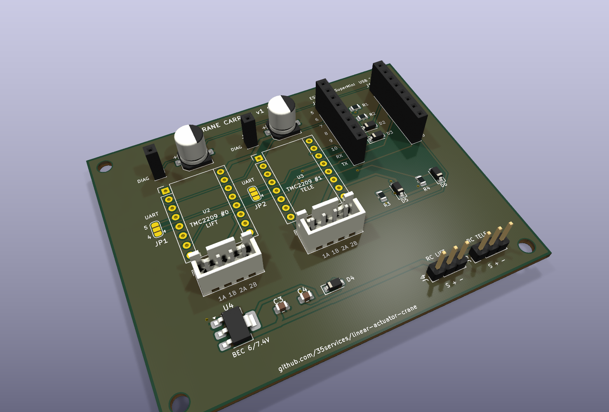
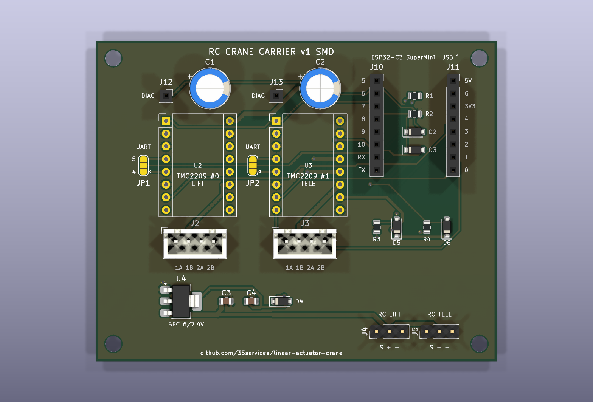
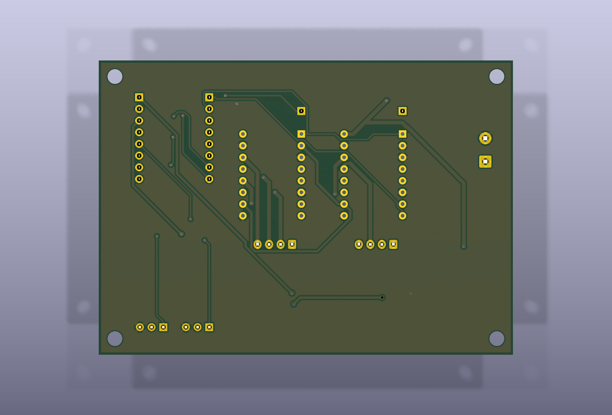
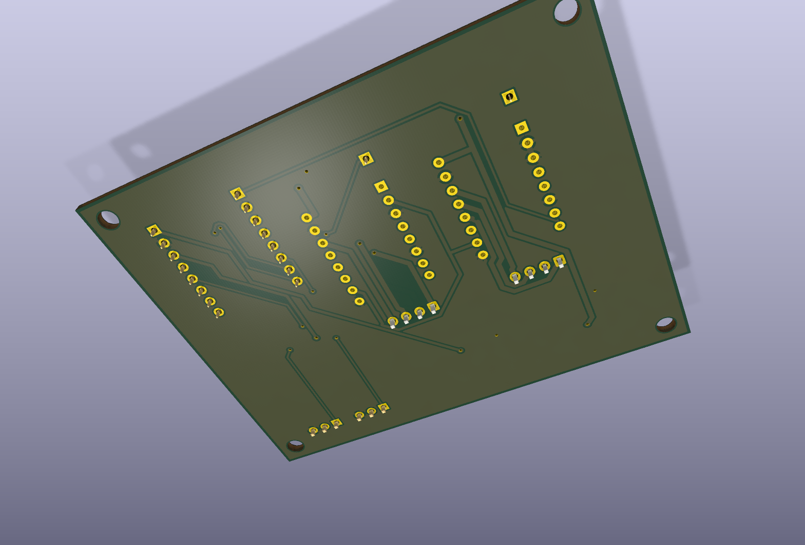
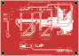

# Carrier PCB

An 80 × 64 mm two‑layer carrier board. The ESP32‑C3 SuperMini and both TMC2209 StepStick
drivers plug into female headers. Everything from the
[wiring diagram](../README.md#3-wiring-diagram) is on the board:
- the power path: everything runs from the ESC's 6 V / 7.4 V BEC through the RC headers,
  with no separate battery input
- the RC input clamps
- the stall‑line diodes and the shared UART

There are **two variants with the same layout and connectors**:

| | [THT – hand soldered](#tht-variant) | [SMD – assembled by JLCPCB](#smd-variant) |
|---|---|---|
| Board | [`rc-crane-carrier.kicad_pcb`](rc-crane-carrier.kicad_pcb) | [`smd/rc-crane-carrier-smd.kicad_pcb`](smd/rc-crane-carrier-smd.kicad_pcb) |
| Gerbers | [`fab/rc-crane-carrier-gerbers.zip`](fab/rc-crane-carrier-gerbers.zip) | [`smd/fab/rc-crane-carrier-smd-gerbers.zip`](smd/fab/rc-crane-carrier-smd-gerbers.zip) |
| Parts | [`bom.csv`](bom.csv) | [`smd/jlcpcb_bom.csv`](smd/jlcpcb_bom.csv) + [`smd/jlcpcb_cpl.csv`](smd/jlcpcb_cpl.csv) |
| 5 V regulator | LM2940‑5.0 (TO‑220) | AMS1117‑5.0 (SOT‑223) |
| You solder | everything | only sockets, headers and JST connectors |
| DRC | 0 violations, 0 unconnected | 0 violations, 0 unconnected |

---

## THT variant



| Top | Bottom |
|---|---|
|  |  |

| 3D, from below | Copper + silkscreen, front | Copper + silkscreen, back (mirrored) |
|---|---|---|
|  |  |  |

### Parts (THT)

| Ref | Qty | Part | Notes |
|-----|-----|------|-------|
| J10, J11 | 2 | Female header 1×8, 2.54 mm | SuperMini socket |
| U2, U3 | 4 | Female header 1×8, 2.54 mm | Two per TMC2209 StepStick |
| J12, J13 | 2 | Female header 1×1 | DIAG wire from each module, see [notes](#notes-for-both-variants) |
| C1, C2 | 2 | 100 µF 35 V electrolytic, D8 mm, 3.5 mm pitch | Driver VM buffer, **required** |
| C3 | 1 | 470 nF ceramic, 5 mm pitch | LM2940 input |
| C4 | 1 | 47 µF 16 V electrolytic, D6.3 mm, 2.5 mm pitch | LM2940 output, needs ≥ 22 µF |
| U4 | 1 | LM2940CT‑5.0 (TO‑220) | 5 V from the BEC |
| D2, D3 | 2 | 1N4148 | DIAG OR |
| D4 | 1 | 1N5817 | LDO → SuperMini 5V, blocks USB back‑feed |
| D5, D6 | 2 | BAT85 | RC signal clamp to 3V3 |
| R1, R3, R4 | 3 | 1 kΩ | UART TX, RC series resistors |
| R2 | 1 | 10 kΩ | DIAG pull‑down |
| J2, J3 | 2 | JST‑XH 4‑pin (B4B‑XH‑A) | Motors |
| J4, J5 | 2 | Pin header 1×3 | RC channels |

Solder **R1, R2, D2 and D3 first**: they sit under the SuperMini. Then the sockets.

---

## SMD variant



| Top | Bottom |
|---|---|
|  |  |

| 3D, from below | Copper + silkscreen, front | Copper + silkscreen, back (mirrored) |
|---|---|---|
|  |  |  |

JLCPCB places all SMD parts. You only solder the through‑hole connectors afterwards. The
ordering steps, part numbers and checks are in [`smd/README.md`](smd/README.md).

| Ref | Part | LCSC | |
|-----|------|------|---|
| C1, C2 | 100 µF 35 V electrolytic, 6.3×7.7 mm | [C2836442](https://www.lcsc.com/product-detail/C2836442.html) | extended |
| C3 | 10 µF 25 V 0805 | [C15850](https://www.lcsc.com/product-detail/C15850.html) | |
| C4 | 22 µF 25 V 0805 | [C45783](https://www.lcsc.com/product-detail/C45783.html) | |
| U4 | AMS1117‑5.0 SOT‑223 | [C6187](https://www.lcsc.com/product-detail/C6187.html) | |
| D2, D3 | 1N4148W SOD‑123 | [C81598](https://www.lcsc.com/product-detail/C81598.html) | basic |
| D4, D5, D6 | B5819W SOD‑123 | [C8598](https://www.lcsc.com/product-detail/C8598.html) | basic |
| R1, R3, R4 | 1 kΩ 0805 | [C17513](https://www.lcsc.com/product-detail/C17513.html) | basic |
| R2 | 10 kΩ 0805 | [C17414](https://www.lcsc.com/product-detail/C17414.html) | basic |

Every part number was checked against its LCSC product page while the board was being
designed. Stock changes, so JLCPCB shows you current availability when you upload the BOM.

**Why the AMS1117 instead of the LM2940?** I couldn't verify an SMD LM2940 in JLCPCB's
library. The AMS1117‑5.0 needs about 1.1 V more input than it outputs, so on the 6 V BEC
setting the SuperMini gets about 4.6 V after the Schottky diode. That's plenty for its own
3.3 V regulator. On 7.4 V it's a full 5 V. It's stable with the 22 µF ceramic on its
output.

---

## Before you order: check these (both variants)

1. **SuperMini pinout.** Clones differ. The board assumes this layout, seen from the top
   with USB‑C pointing to the top board edge:

   | left row (J10) | right row (J11) |
   |---|---|
   | GPIO5 | 5V |
   | GPIO6 | GND |
   | GPIO7 | 3V3 |
   | GPIO8 | GPIO4 |
   | GPIO9 | GPIO3 |
   | GPIO10 | GPIO2 |
   | GPIO20 (RX) | GPIO1 |
   | GPIO21 (TX) | GPIO0 |

   Every socket pin is labelled on the silkscreen. Lay your SuperMini on the top render and
   compare. If yours differs, change `ESP_LEFT` / `ESP_RIGHT` in `generate_pcb.py` and
   rebuild. The row spacing is 15.24 mm (`ESP_ROW_SPACING`).
2. **TMC2209 module pinout.** The board uses the standard StepStick layout. Pins 1–8 on
   the left: EN, MS1, MS2, (4), (5), CLK, STEP, DIR. Pins 16–9 on the right: VM, GND, 2B,
   2A, 1A, 1B, VIO, GND. BTT and FYSETC v3 modules match this.
   * **CLK (pin 6) is tied to GND,** so the driver uses its internal clock.
   * **UART is on pin 4 or pin 5, depending on the brand.** Bridge **JP1** (driver #0) and
     **JP2** (driver #1) to the matching side. The silkscreen says `5` / `4`. BTT v1.3 uses
     pin 4 ("RX"). If you aren't sure, bridge both sides: on BTT and FYSETC modules, pins 4
     and 5 are both PDN_UART.

## Notes for both variants

* **DIAG:** the TMC2209 pulls DIAG high when the motor stalls, which is used for homing
  without end switches.
  * The DIAG pin isn't part of the 16‑pin StepStick layout. Run a short female‑to‑male
    Dupont jumper from the module's DIAG pin to J12 (driver #0) or J13 (driver #1).
  * You don't need the wires if you set `USE_STALLGUARD false`.

  
* **Power:** there is no battery input. Everything runs from the ESC's BEC (Hobbywing
  QuicRun Fusion SE: 6 V / 7.4 V, 4 A). It arrives through the `+` pin of the RC headers,
  because the receiver passes it through.
  * **Drivers:** VM comes straight from the BEC rail. The TMC2209 works from 4.75 V, and
    the two small steppers draw only about 0.3–0.6 A together.
  * **ESP32:** fed through the 5 V regulator.
  * **Cabling:** both RC headers share `+` and `−`, so plug in both servo leads to spread
    the current over two cables.
  * **Header pin order:** **`S + −`**, with signal on the square pad. The `+` pin is in the
    middle, so a servo plug put on backwards only swaps signal and GND and nothing gets a
    wrong voltage. That's why there's no reverse‑polarity diode.
* **Motors:** J2 / J3 are `1A 1B 2A 2B`, with the coil pairs next to each other.
* **The potentiometer on the TMC2209 module** does nothing in this setup: the firmware sets
  the current over UART and switches VREF off with `I_scale_analog(false)`.
* **Fab settings:** 2 layers, 1.6 mm, any colour. Minimum track and clearance is 0.2 mm,
  well within every cheap fab's rules.

---

## Rebuilding

```bash
./pcb/build.sh                # both variants: place, re-route, pour, DRC, Gerbers, renders
./pcb/build.sh smd            # one variant
./pcb/build.sh tht outputs    # only DRC + Gerbers + renders from the existing board
```

This needs KiCad 10 (`brew install --cask kicad`) and Java 21+. The
[Freerouting](https://github.com/freerouting/freerouting) autorouter is downloaded into
`pcb/.cache/` on first run.

* **Changing the circuit:** everything is in tables at the top of
  [`generate_pcb.py`](generate_pcb.py).
  * `PARTS`: the THT parts, each a footprint, its position and a pad → net map.
  * `SMD_PARTS`: SMD replacements with their LCSC numbers.
  * `SILK`: the silkscreen texts.
* **Hand edits:** the board can also be edited in KiCad, but a full `build.sh` re‑routes
  and overwrites them. After hand edits, use `build.sh <variant> outputs`.
* **No schematic file:** the connectivity is defined in `generate_pcb.py`, and the
  [wiring diagram](../README.md#3-wiring-diagram) in the main README is the schematic view.
