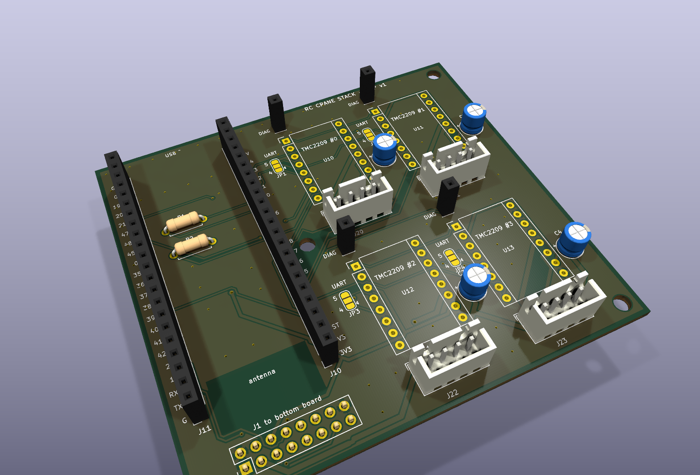
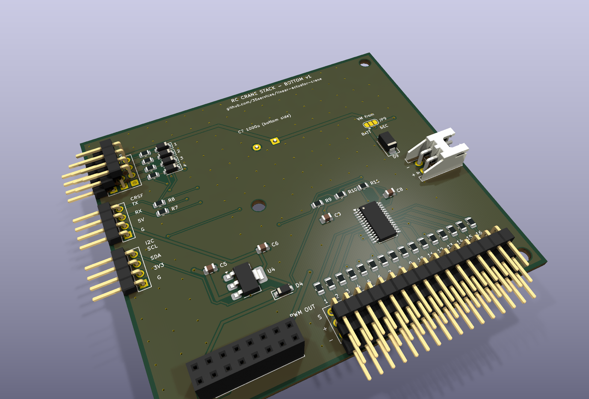
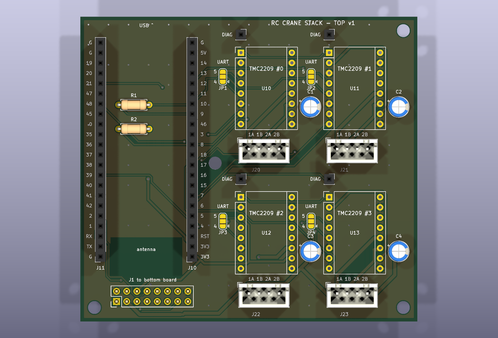
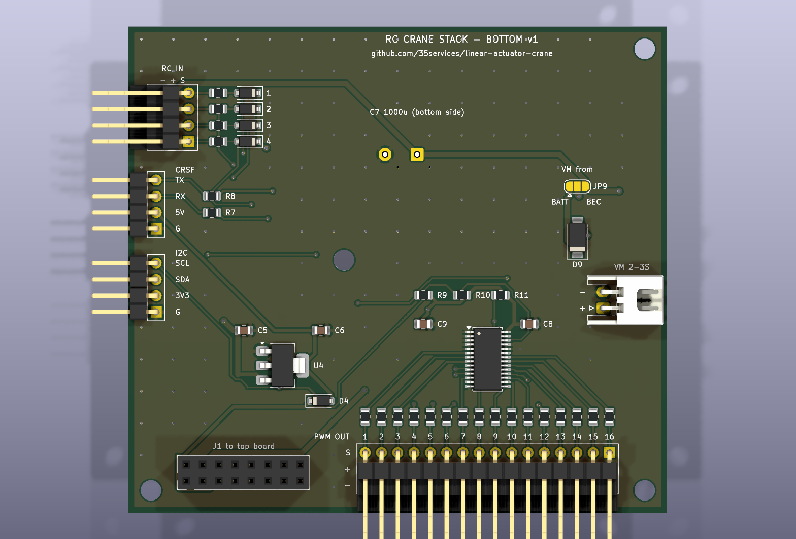

# Advanced board, stacked – two 84 × 76 mm boards

The [advanced board](../advanced/README.md) split in two and stacked: about **half the
footprint** of the single 100 × 100 mm board, at the cost of height and a second PCB. Same
circuit, same ESP32 pin assignment, so the same firmware runs on both versions.

| Top board – drivers | Bottom board – I/O |
|---|---|
|  |  |
| ESP32‑S3‑DevKitC‑1, 4 × TMC2209, 4 motor connectors, DIAG sockets, UART jumpers | PCA9685 + 16 servo/ESC outputs, 4 RC inputs, CRSF/SBUS, I²C, 5 V regulator, motor supply input |
| **Through‑hole only**, no assembly needed | **SMD assembled by JLCPCB** (37 placements, PCA9685 is the only extended part) |
| DRC: 0 violations, 0 unconnected | DRC: 0 violations, 0 unconnected |

> **Status:** designed and checked (DRC, same netlist as the single board), not built yet.

## How the stack goes together

```
         DevKitC-1                 TMC2209 modules
     ┌───────────────┐         ┌──┐ ┌──┐
     │  in sockets   │         │  │ │  │
  ═══╧═══════════════╧═════════╧══╧═╧══╧═══   top board (drivers)
   ║      ▼ J1 male header, soldered in from below          ║  M3 standoffs
   ║  ┌────────┐                                            ║  ~11 mm
   ║  │ J1 2x8 │    PCA9685   ...                           ║
  ═╪══╧════════╧═══════════════════════════════════════════╪═  bottom board (I/O)
 ◄═╡ RC in, CRSF, I2C                   PWM out 1-16  ═══►  ═╡ VM in
   right-angle headers, pointing out of the board edges        C7 (1000 µF) underneath
```

* **Connection:** a 2×8 stacking pair, **J1**. The bottom board gets a female header
  (8.5 mm), the top board a male header soldered in **from the bottom side**. Same
  position on both boards. That gives about 11 mm between the boards.
* **Mechanics:** 4 M3 holes at the same positions on both boards. Use 11 mm spacers between
  the boards (female/female) and standoffs below the bottom board.
* **Everything on the bottom board is reachable from the side:** the RC inputs, CRSF and I²C
  headers point out of the left edge, the 16 outputs out of the bottom edge, the motor
  supply (side‑entry JST‑XH) out of the right edge. All are lower than the 11 mm gap.
* **C7 (1000 µF servo buffer) sits on the underside** of the bottom board, so it doesn't
  need room in the gap. Leave about 17 mm under the stack, or lay it flat.

### J1 – what goes between the boards

| Pin | Net | | Pin | Net |
|---|---|---|---|---|
| 1 | GND | | 2 | GND |
| 3 | VM (motor supply, from JP9) | | 4 | VM |
| 5 | +5V (to the DevKit) | | 6 | +3V3 (from the DevKit) |
| 7 | RC input 1 → GPIO1 | | 8 | RC input 2 → GPIO2 |
| 9 | RC input 3 → GPIO42 | | 10 | RC input 4 → GPIO41 |
| 11 | serial RX → GPIO40 | | 12 | serial TX ← GPIO39 |
| 13 | SDA (GPIO47) | | 14 | SCL (GPIO21) |
| 15 | PCA9685 OE (GPIO48) | | 16 | GND |

VM uses two pins (about 3 A each), more than the four small steppers need.

---

## Top board – drivers



* **DevKitC‑1 standing on its head:** USB at the top board edge, antenna at the bottom over
  a copper‑free area. The STEP/DIR/UART/DIAG row faces the drivers.
* **4 TMC2209 in a 2 × 2 grid**, each with DIAG socket, UART pin jumper (JP1–JP4, same as
  the small boards), JST‑XH motor connector and 100 µF VM capacitor. Addresses 0–3 are set by
  copper.
* R1 (1 kΩ UART) and R2 (10 kΩ EN pull‑up) are through‑hole, under the DevKit.

| Ref | Part |
|---|---|
| J10, J11 | 2 × female header 1×22 – DevKitC‑1 |
| U10–U13 | 8 × female header 1×8 – TMC2209 sockets |
| J12–J15 | 4 × female header 1×1 – DIAG |
| J20–J23 | 4 × JST‑XH 4‑pin B4B‑XH‑A – motors |
| C1–C4 | 100 µF 25 V electrolytic, D5 mm, 2 mm pitch |
| R1, R2 | 1 kΩ, 10 kΩ, axial |
| J1 | male header 2×8, 2.54 mm – **solder it in from the bottom side** |
| JP1–JP4 | solder jumpers, UART pin 4/5 |

## Bottom board – I/O



| Ref | Connector | Pins |
|---|---|---|
| J4 | RC in, right angle 3 × 4, left edge | rows from the board: `−` `+` `S`, channel 1 at the top |
| J7 | Serial receiver, right angle 1 × 4, left edge | `G 5V RX TX` (5 V for ELRS receivers) |
| J8 | I²C, right angle 1 × 4, left edge | `G 3V3 SDA SCL` |
| J30 | PWM out, right angle 3 × 16, bottom edge | rows from the board: `−` `+` `S`, channel 1 on the left |
| J9 | Motor supply, JST‑XH 2‑pin side entry, right edge | `+ −`, 2–3S, through an SS34 |
| J1 | to the top board, female 2×8 | see above |

* **JP9 selects the motor supply, as on the single board:** bridge `BEC` (pads 2–3) or
  `BATT` (pads 1–2). The drivers get no motor power until you do.
* The servo rows on the side headers are stacked on top of each other: `−` lowest (next to
  the board), `S` on top. Plug the servo leads in with the signal wire up.

| Hand‑soldered | |
|---|---|
| J4 | right‑angle pin headers for a 3 × 4 block (3‑row right‑angle header, cut to length) |
| J30 | right‑angle 3‑row header, 16 columns |
| J7, J8 | right‑angle pin header 1×4 |
| J9 | JST‑XH S2B‑XH‑A (side entry) |
| J1 | female header 2×8, 8.5 mm |
| C7 | 1000 µF 16 V electrolytic, D10 mm, **on the bottom side** |
| JP9 | solder jumper, VM source |

**Ordering:** upload `bottom/fab/rc-crane-stack-bottom-gerbers.zip`, `bottom/jlcpcb_bom.csv`
and `bottom/jlcpcb_cpl.csv` as described for the
[advanced board](../advanced/README.md#ordering-jlcpcb), with the same polarity checks. The
top board is a plain PCB order: `top/fab/rc-crane-stack-top-gerbers.zip`.

## Single board or stack?

| | [Single](../advanced/README.md) | Stack |
|---|---|---|
| Footprint | 100 × 100 mm | **84 × 76 mm** |
| Height (without DevKit/modules) | one board | two boards, ~11 mm apart |
| PCBs / assembly orders | 1 / 1 | 2 / 1 (the top board needs no assembly) |
| Servo/RC connectors | vertical, plug from above | right angle, plug from the side |
| Cost | lowest | a second PCB, a few euros more |

## Rebuilding

```bash
./pcb/build.sh stack          # both boards
./pcb/build.sh stack-top      # one board
```

[`generate_stack.py`](generate_stack.py) holds both boards' tables and shares the outline,
holes and J1 position between them. The board building itself is
[`../board_tools.py`](../board_tools.py), the same as for the single advanced board.
