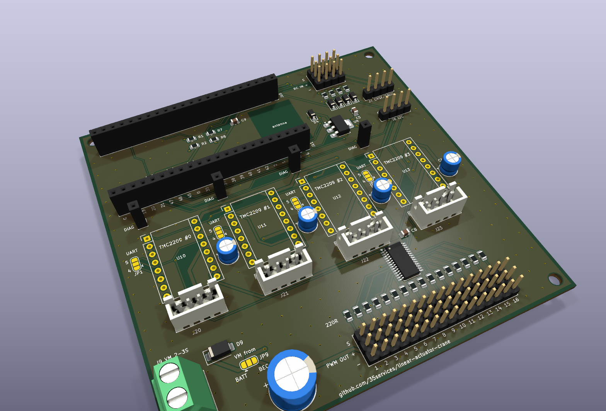
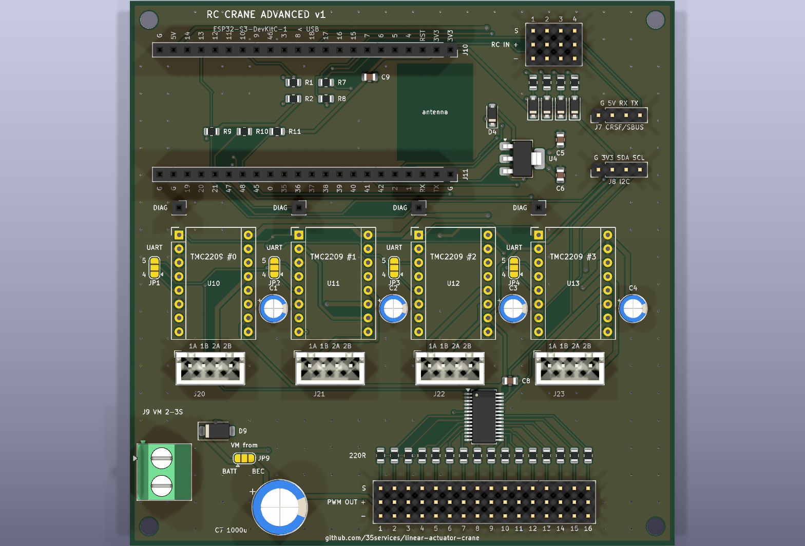
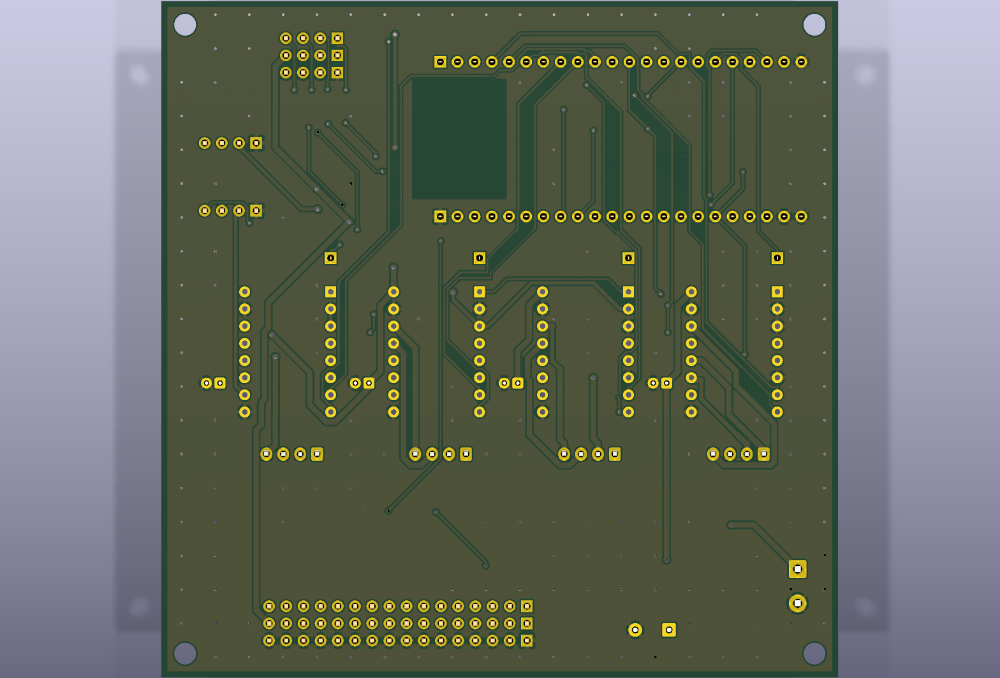
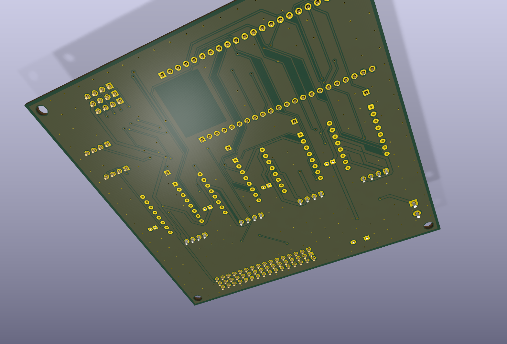
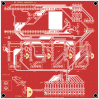
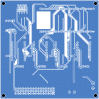

# Advanced board – ESP32‑S3, 4 steppers, 16 PWM outputs

A 100 × 100 mm two‑layer board for the bigger concept: the ESP32 as receiver, as a
multiplexer between receiver and servos/ESC, or reading the drive channels in "crane mode".



| | |
|---|---|
| ESP32 | **ESP32‑S3‑DevKitC‑1** in two 1×22 sockets, USB over the left board edge |
| Steppers | **4 × TMC2209** StepStick sockets on one UART (addresses 0–3), DIAG per driver, 4 × JST‑XH motor connectors |
| Outputs | **16 servo/ESC outputs** from a PCA9685 (I²C), `S + −` block like a receiver, 220 Ω per channel |
| Inputs | **4 RC PWM inputs** (`S + −` block, 1 kΩ + clamp to 3V3) and a **CRSF/SBUS port** for a serial receiver |
| Extras | I²C header (second PCA9685, display, …) |
| Power | everything from the BEC rail; drivers' motor supply selectable: BEC or 2–3S battery |
| Assembly | 39 SMD parts by JLCPCB (12 part types, **1 extended**: the PCA9685), the rest hand‑soldered |
| DRC | 0 violations, 0 unconnected |

> **Smaller footprint?** The same circuit as a [stack of two 84 × 76 mm boards](../advanced-stack/README.md).

> **Status:** the board is designed and checked (DRC, netlist), but not built or tested yet.
> The current firmware is for the small ESP32‑C3 board; the firmware for this board
> (4 axes, PCA9685 outputs, CRSF/SBUS, crane mode) is the next step.

| Top | Bottom |
|---|---|
|  |  |

| 3D, from below | Copper + silkscreen, front | Copper + silkscreen, back (mirrored) |
|---|---|---|
|  |  |  |

---

## ESP32 pin assignment

The DevKitC‑1 lies on its side: **USB connectors over the left board edge**, antenna to the
right over a copper‑free area. J10 is the board's J1 header (top row), J11 its J3 header.
Every socket pin is labelled on the silkscreen.

| GPIO | Function | | GPIO | Function |
|---|---|---|---|---|
| 4 / 5 | STEP / DIR driver #0 | | 1 | RC input 1 |
| 6 / 7 | STEP / DIR driver #1 | | 2 | RC input 2 |
| 15 / 16 | STEP / DIR driver #2 | | 42 | RC input 3 |
| 17 / 18 | STEP / DIR driver #3 | | 41 | RC input 4 |
| 8 | EN, all drivers (10 kΩ pull‑up: off at boot) | | 40 | serial receiver RX (CRSF/SBUS in) |
| 9 | TMC UART TX (via 1 kΩ) | | 39 | serial receiver TX (CRSF telemetry) |
| 10 | TMC UART RX (PDN_UART of all drivers) | | 47 / 21 | I²C SDA / SCL (PCA9685, I²C header) |
| 11 / 12 / 13 / 14 | DIAG driver #0 / #1 / #2 / #3 | | 48 | PCA9685 OE (10 kΩ pull‑up: outputs off at boot) |

**Kept free:** the strapping pins 0, 3, 45, 46; USB 19/20; 35–37 (used by the octal PSRAM
on N8R8/N16R8 modules); 38 (RGB LED on v1.1); 43/44 (USB‑UART, serial monitor).

* **DIAG inputs:** use the ESP's internal pull‑downs (`INPUT_PULLDOWN`).
* **SBUS** is an inverted signal. The S3's UART inverts it in hardware, no inverter
  needed.
* **v1.0 DevKitC‑1:** its RGB LED sits on GPIO48, which here is the PCA9685 OE line. That
  only makes the LED flicker.

## Connectors

| Ref | Connector | Pins |
|---|---|---|
| J4 | RC in, 3 × 4 block | rows `S + −`, channels 1–4 |
| J30 | PWM out, 3 × 16 block | rows `S + −`, channels 1–16 = PCA9685 LED0–15 |
| J7 | Serial receiver, 1 × 4 | `G 5V RX TX` (from the ESP's side: receiver TX → `RX`). Gets 5 V from the regulator: ELRS receivers want 5 V, not the 6–7.4 V BEC |
| J8 | I²C, 1 × 4 | `G 3V3 SDA SCL` |
| J9 | VM battery, screw terminal | `+ −`, 2–3S LiPo, through an SS34 diode (reverse polarity) |
| J20–J23 | Motors, JST‑XH 4 | `1A 1B 2A 2B` |
| J12–J15 | DIAG, 1 × 1 socket | jumper wire from each module's DIAG pin, see [main README](../../README.md#3-wiring-diagram) |

## Power

* **One rail like in a receiver:** the `+` pins of all 20 three‑pin headers (RC in and
  PWM out) are one rail, VBEC. The ESC plugged into an output powers the whole board
  through its BEC, and every servo gets its power from the same rail. C7 (1000 µF) buffers
  servo current peaks.
* **ESP32 and serial receiver:** 5 V from an AMS1117‑5.0 on VBEC, then a Schottky diode to
  the DevKit's 5V pin, so USB can't back‑feed the regulator.
* **Driver motor supply (VM): bridge JP9, the drivers get no motor power until you do.**
  * `BEC` side (pads 2–3): from the BEC rail, like the small boards.
  * `BATT` side (pads 1–2): from a 2–3S battery on J9. That takes the stepper load off the
    4 A BEC when many servos run too. The TMC2209 is fine with up to 29 V.
  * Never bridge all three pads.
* Up to 16 servos can draw far more than 4 A. For many or strong servos use a stronger
  external BEC on the rail, and then **remove the red wire of the ESC's lead**, so two BECs
  never fight.

## Ordering (JLCPCB)

| File | Upload as |
|------|-----------|
| [`fab/rc-crane-advanced-gerbers.zip`](fab/rc-crane-advanced-gerbers.zip) | Gerber file |
| [`jlcpcb_bom.csv`](jlcpcb_bom.csv) | BOM |
| [`jlcpcb_cpl.csv`](jlcpcb_cpl.csv) | CPL / pick‑and‑place |

Settings as for the [SMD carrier](../smd/README.md#ordering-steps): 2 layers, 1.6 mm,
assembly on the top side, "Confirm Parts Placement" on. In the placement preview, check:

| Ref | Polarity mark |
|---|---|
| U5 (PCA9685) | pin 1 dot, top left |
| U4 (AMS1117) | tab = OUT, the three pins on the left |
| D4, D20–D23 (B5819W), D9 (SS34) | cathode band = pad 1 |

**Extended parts:** only the PCA9685 ([C2678753](https://www.lcsc.com/product-detail/C2678753.html),
fallback C92206), so one setup fee of about $3. Everything else is a basic part. See
[extended parts](../README.md#jlcpcb-extended-parts-cost-tracking) and
`python3 pcb/check_jlc_parts.py` for current stock.

### Hand‑soldered

| Ref | Part |
|---|---|
| J10, J11 | 2 × female header 1×22, 2.54 mm – DevKitC‑1 |
| U10–U13 | 8 × female header 1×8 – TMC2209 sockets |
| J12–J15 | 4 × female header 1×1 – DIAG |
| J20–J23 | 4 × JST‑XH 4‑pin B4B‑XH‑A – motors |
| J4 | pin headers for a 3 × 4 block (e.g. 3 × 1×4 or cut from a 3×40 strip) |
| J30 | pin headers for a 3 × 16 block |
| J7, J8 | pin header 1×4 |
| J9 | screw terminal 2‑pin, 5.08 mm (only if you use the battery input) |
| C1–C4 | 100 µF 25 V electrolytic, D5 mm, 2 mm pitch – driver VM buffer, **required** |
| C7 | 1000 µF 16 V electrolytic, D10 mm, 5 mm pitch – servo rail buffer |
| JP1–JP4 | UART pin 4/5 per driver brand, see the [PCB README](../README.md#before-you-order-check-these-both-variants) |
| JP9 | VM source, see [Power](#power) |

## Before you order

1. **DevKitC‑1 clone pinout.** The board follows Espressif's v1.1 drawing (25.4 × 62.74 mm,
   rows 22.86 mm apart, pin 1 = 3V3 / G at the antenna end). Lay your board on the top
   render and compare the pin labels.
2. **TMC2209 modules and UART pin:** as for the small boards, see the
   [PCB README](../README.md#before-you-order-check-these-both-variants). Addresses are
   fixed by copper: #0 = 0, #1 = 1 (MS1 high), #2 = 2 (MS2 high), #3 = 3 (both high).

## Rebuilding

```bash
./pcb/build.sh advanced          # place, route, clean up, pour, DRC, Gerbers, renders
./pcb/build.sh advanced outputs  # only DRC + Gerbers + renders from the existing board
```

Everything is in [`generate_advanced.py`](generate_advanced.py): the pin map (`ESP_NETS`),
the parts table and the silkscreen. After autorouting it removes vias that only connect one layer, widens the
router's neck‑downs to 0.15 mm where the clearance allows, and adds GND stitching vias so
both ground pours are one net. That code is shared with the stacked boards in
[`../board_tools.py`](../board_tools.py).
